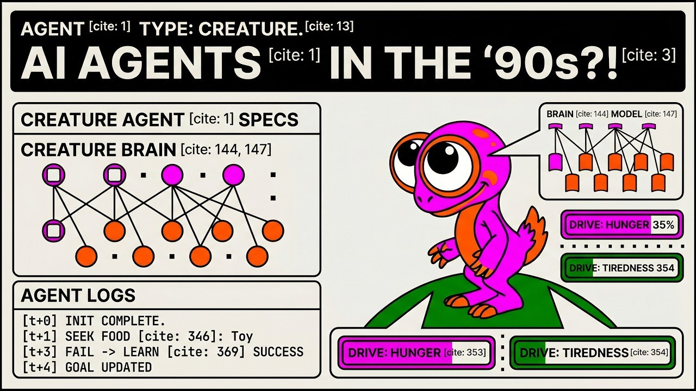

# Creatures 3 / Docking Station engine port (Linux and macOS)

A C++ port of the Creatures 3 / Docking Station engine (`lc2e`) that runs
natively on Linux and macOS, including Apple Silicon. The engine ships with
browser-based developer tools for watching creatures live and an MCP server
so AI agents can observe and control the simulation.

[](https://www.youtube.com/watch?v=Ymm6pWf1W0Q)

Before LLMs and modern AI agents, there were Norns. In this video Cyril
Sadovsky unpacks the 1997 paper *Creatures: Entertainment Software Agents
with Artificial Life* by Cliff and Grand, and uses this port's developer
tools to show the biochemistry, drives and bottom-up neural network running
in real time.

> [!IMPORTANT]
> **This repository contains only the engine. No game data is included.**
> You need a legitimate copy of *Creatures Exodus* (Creatures 3 plus Docking
> Station) and must supply the original game files yourself.

| Store | Link |
|---|---|
| Steam | [Creatures: Docking Station + Creatures 3](https://store.steampowered.com/app/1797350/Creatures_Docking_Station__Creatures_3/) |
| GOG | [Creatures Exodus](https://www.gog.com/en/game/creatures_exodus) |

Windows users do not need this port; the game runs natively there.

## Prerequisites

- CMake 3.10 or newer and a C++11 compiler (GCC, Clang or Apple Clang)
- SDL2 and SDL2_mixer
- zlib
- Node.js 18 or newer, only for the MCP adapter and the developer-tools tests
- Firefox, only for the browser test suites

```bash
# Fedora
sudo dnf install cmake gcc-c++ SDL2-devel SDL2_mixer-devel zlib-devel nodejs

# Debian / Ubuntu
sudo apt install cmake g++ libsdl2-dev libsdl2-mixer-dev zlib1g-dev nodejs

# macOS (Homebrew)
brew install cmake sdl2 sdl2_mixer zlib node
```

## Building

```bash
cmake -S . -B build
cmake --build build
```

The executable is `build/lc2e`. The first configure downloads GoogleTest.

## Game data setup

The engine reads two configuration files from the game data directory.

### `machine.cfg`

Tells the engine where the assets are, relative to the `Docking Station`
folder. The Steam version ships a `machine.cfg` with Windows absolute paths;
replace it with relative ones:

```ini
"Auxiliary 1 Backgrounds Directory" "../Creatures 3/Backgrounds"
"Auxiliary 1 Body Data Directory" "../Creatures 3/Body Data"
"Auxiliary 1 Bootstrap Directory" "../Creatures 3/Bootstrap"
"Auxiliary 1 Catalogue Directory" "../Creatures 3/Catalogue"
"Auxiliary 1 Exported Creatures Directory" "../Creatures 3/My Creatures"
"Auxiliary 1 Genetics Directory" "../Creatures 3/Genetics"
"Auxiliary 1 Images Directory" "../Creatures 3/Images"
"Auxiliary 1 Main Directory" "../Creatures 3"
"Auxiliary 1 Overlay Data Directory" "../Creatures 3/Overlay Data"
"Auxiliary 1 Resource Files Directory" "../Creatures 3/My Agents"
"Auxiliary 1 Sounds Directory" "../Creatures 3/Sounds"
"Backgrounds Directory" Backgrounds
"Body Data Directory" "Body Data"
"Bootstrap Directory" Bootstrap
"Catalogue Directory" Catalogue
"Creature Database Directory" "Creature Galleries"
"Display Type" 2
"Exported Creatures Directory" "My Creatures"
"Game Name" "Docking Station"
"Genetics Directory" Genetics
"Images Directory" Images
"Journal Directory" Journal
"Main Directory" .
"Overlay Data Directory" "Overlay Data"
"Resource Files Directory" "My Agents"
"Sounds Directory" Sounds
"Users Directory" Users
"Win32 Auxiliary Game Name 1" "Creatures 3"
"Worlds Directory" "My Worlds"
```

The `Auxiliary 1` entries point at a `Creatures 3` folder next to
`Docking Station`. They are only needed for docked worlds, when you own
Creatures 3 as well.

### `user.cfg`

Window geometry and display settings. Created automatically if missing:

```ini
"Default Background" DS_splash
"Default Munge" DS_music.mng
DiskSpaceCheck 33554432
DiskSpaceCheckSystem 78643200
FlightRecorderMask 33
FullScreen 0
WindowBottom 600
WindowLeft 100
WindowRight 900
WindowTop 100
```

## Running

```bash
./build/lc2e --game-dir "/path/to/Docking Station"
```

| Flag | Description |
|---|---|
| `--game-dir <path>`, `-d` | Game data directory (defaults to the working directory) |
| `--world <name>`, `-w` | Load a named world directly, skipping the startup menu |
| `--gamespeed <N>`, `-s` | Speed multiplier, e.g. `3` or `0.5` |
| `--headless` | No display or audio; implies `--tools`, `--mcp`, `--no-music`, `--no-sound`. Ctrl+C shuts down gracefully |
| `--run-cos <file>` | Execute a `.cos` CAOS script after the world loads; repeatable |
| `--max-ticks <N>` | Run N ticks, save the world and exit |
| `--tools [path]` | Start the developer tools server on port 9980, optionally from another `tools/` directory |
| `--mcp` | Start the API server for AI agents on port 9980, without the browser UI |
| `--allow-remote-tools` | Token-protected access to the API from other machines |
| `--no-music`, `--no-sound` | Disable music or all sound |
| `--help`, `-h` | Print usage |

## Developer tools

`--tools` embeds a browser Observatory in the engine: live creature
observation, drives, biochemistry, organs, brain lobes and tracts, an
ethology timeline, cohort comparison, world ecology, a CAOS workbench with a
source-level debugger, structured logs, a copy-first genetics kit, and an
in-app wiki. There are no external dependencies on the engine side.

```bash
./build/lc2e -d "/path/to/Docking Station" --tools
# open http://localhost:9980
```

The UI guide and REST API reference are in [`tools/TOOLS.md`](tools/TOOLS.md);
the same wiki is served inside the tools. The tools can execute CAOS, save
worlds and write genomes, so use a copy of your game data for experiments.

## AI agent access (MCP)

The engine exposes its API through the
[Model Context Protocol](https://modelcontextprotocol.io/). An agent can
execute CAOS, list creatures, read chemistry and brain state, set breakpoints,
step scripts, create or load worlds and control simulation speed.

```bash
cd mcp && npm install                                   # once
./build/lc2e -d "/path/to/Docking Station" --mcp       # or --tools, or --headless
```

Claude Code picks up the adapter from `.mcp.json` when opened in this
repository. Any other stdio MCP client runs `node mcp/server.js` with
`ENGINE_URL=http://127.0.0.1:9980`. Details and the full tool list are in
[`mcp/MCP.md`](mcp/MCP.md).

## Working with AI agents on this repository

`AGENTS.md` is the agent guide, read by Claude Code (through `CLAUDE.md`),
Codex and other tools that honour it. Task-specific knowledge lives in
skills under `.agents/skills/`: `caos-mcp` (writing CAOS), `developer-tools`
(tools architecture and extension), `engine-testing` (unit, link-seam and
integration testing) and `run-creatures-experiment` (controlled four-Norn
experiments).

## Testing

```bash
ctest --test-dir build --output-on-failure
```

This runs the GoogleTest unit suite, the Node model tests for the developer
tools, and real Firefox interaction tests against a synthetic engine (they
skip when Firefox is absent). Integration tiers that launch the real engine
need game data and `-DENABLE_INTEGRATION_TESTS=ON`; see the `engine-testing`
skill.

## Eat elevator bug fix

Hungry Norns could congregate around the Norn Meso elevator button and pace
across the same room boundaries for long periods, the so-called "eat
elevator" bug: the Norn selected Eat for a food smell without a concrete food
agent in `IT`, then stayed blocked in `APPR` while following the room-level
cellular automata (CA) gradient.

The gradient was meaningful, since food existed on another lift level, but
`Map::WhichDirectionToFollowCA()` inferred directions for linked rooms from
their centre points. The link from Meso room 658 to lower room 621 is offset
both right and down, and because the horizontal displacement is slightly
larger the engine classified it as `GO_RIGHT` instead of `GO_DOWN`. The Norn
never received the Down drive that would let the button-and-lift affordance
chain compete with Eat.

The engine now classifies linked rooms with non-overlapping vertical bounds
as Up or Down regardless of horizontal offset; links within overlapping
vertical bands keep the centre-angle classification. The rule is geometric
and hard-codes no room IDs, agents, actions or targets, so Norns remain
responsible for choosing and learning the next action. Implementation:
[`engine/Map/MapCA.cpp`](engine/Map/MapCA.cpp) and
[`engine/Map/MapCA_Logic.h`](engine/Map/MapCA_Logic.h); regression coverage:
[`tests/test_MapCALogic.cpp`](tests/test_MapCALogic.cpp). In MCP validation
all five Norns caught in the loop left the area within 2,000 ticks, and
multi-hour manual runs showed broader exploration and improved survival.

## Branches

- `main`: the Linux and macOS line, developed and tested on Fedora.
- `free_energy_principle_research`: research material on top of `main`.
- `macos-legacy` (tag): the original macOS-only port before the Linux work.

## Known issues

- Camera transmissions from "Camera" agents (the Docking Station Comms Room,
  the Creatures 3 Bridge) render black.
