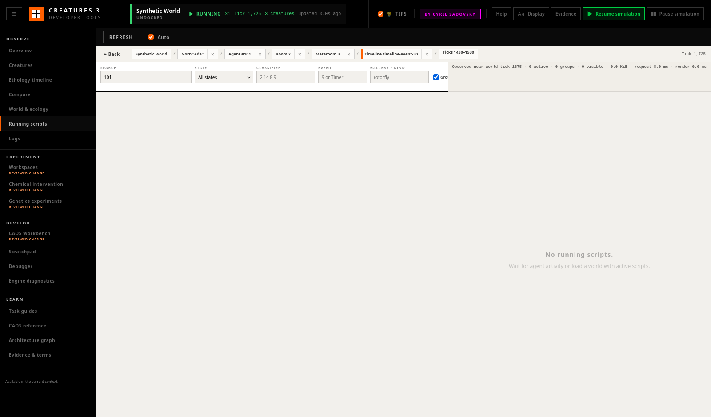
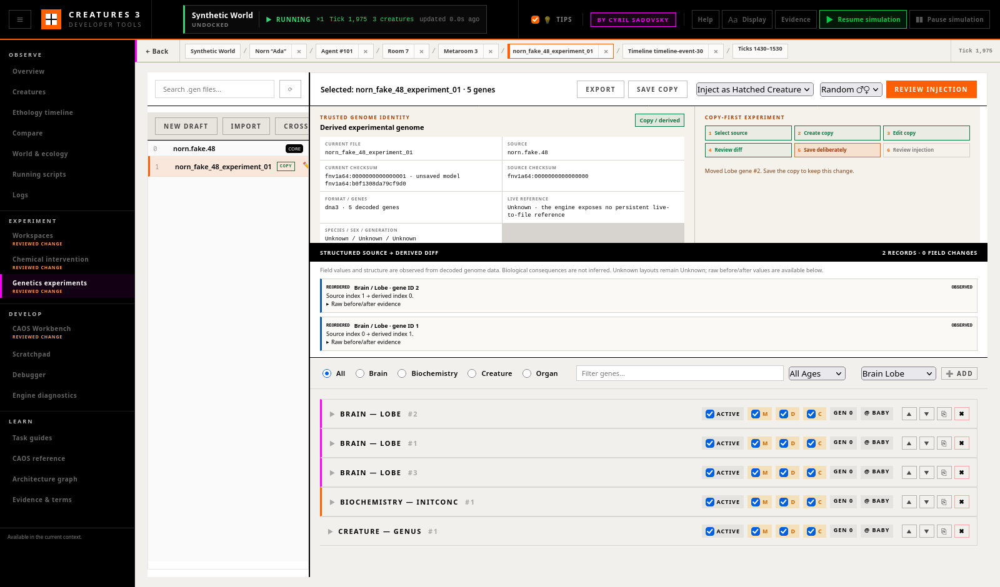
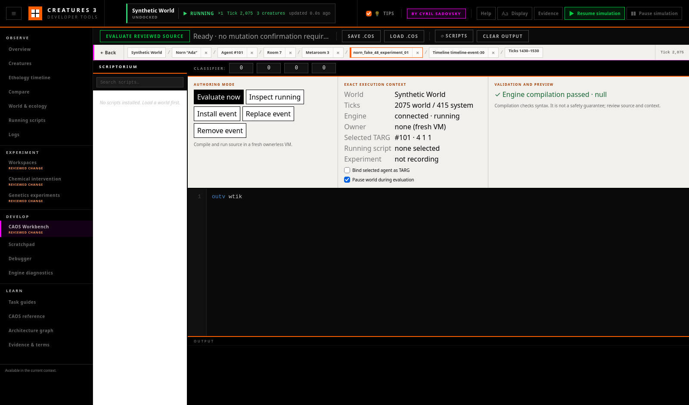

# Creatures 3 — Developer Tools

Browser-based developer tools for the Creatures 3 / Docking Station engine, served directly from the `lc2e` binary. No external dependencies — no Node.js, no relay scripts, no separate processes.


---

## Quick Start

```bash
# Start the engine with developer tools enabled
./build/lc2e -d "$HOME/Creatures Docking Station/Docking Station" --tools

# Open in your browser:
#   http://localhost:9980
```

The tools server runs on port **9980**. When `--tools` is not passed, the server does not start and there is **zero impact** on engine performance.

The API can execute arbitrary CAOS and rewrite genome files, so it serves only
this machine: it binds `127.0.0.1`, sends no CORS headers, and rejects foreign
`Host` headers and cross-origin or cross-site API requests. To use it from
another machine, start `lc2e` with `--allow-remote-tools`. That listens on all
interfaces, requires a token for anything but local requests, and prints an
access URL at startup. Set `LC2E_TOOLS_TOKEN` to choose the token.

Displayed values do not all have the same source or freshness. Direct endpoint
reads are **Observed**; calculations are **Derived**; interpretations are
**Inferred**; and values without adequate capture metadata are **Unknown**.
World-qualified samples record their capture tick and polling interval, and
disconnects make the last sample stale. See the built-in
**Observatory State & Evidence** reference for the shared contract.

### CLI Options

| Flag | Description |
|---|---|
| `--tools` | Start the developer tools server on port 9980 |
| `--tools /path/to/tools` | Override the default tools directory path |

The tools directory is resolved relative to the executable: `<exe_dir>/../tools/`. If this doesn't exist, it falls back to `./tools/` relative to the current working directory. The `--tools /path` form overrides both.

---

## Observatory Navigation

The developer tools open on a calm Observatory overview and organize
workspaces into four intent groups in the collapsible left navigation:
**Observe**, **Experiment**, **Develop**, and **Learn**. Named routes carry
required capabilities, contextual help, and an activity marker. Workspaces
that can lead to mutation are visibly labelled **Reviewed change**; unavailable
routes remain discoverable and explain which connection, world, or creature
selection they need.

The dashboard summarizes the session, creature population, current experiment
or recording, world-qualified interventions, script/log diagnostics, retained
biological pins, and a resumable investigation. It reuses the global session
sample and polls creature/script summaries at a bounded five-second cadence
only while visible. Each workspace still has a contextual toolbar below the
header.

Named deep links use `#observe?route=<id>&tab=<tab>` and can retain the world,
stable selections, and an `at`/`from`/`to` world-tick context. Existing
`#creatures`, `#console`, and other useful flat hashes remain aliases. See the
built-in **Observatory Navigation & Dashboard** guide for the complete route
map, first-visit workflow, migration table, keyboard controls, and responsive
behaviour.

**World/session ribbon:** The persistent header shows the active or requested
world, world type, simulation state, speed, world tick, creature count, and
status-sample age. Click it for exact ticks, connection/source details, pending
load context, and explicit speed controls.

**Simulation controls:** The text-labelled **Resume simulation** and **Pause
simulation** actions control the global engine. Pausing freezes all game ticks
(creature AI, physics, timer scripts, agent updates) while keeping the UI and
debug server responsive.

**Keyboard and display:** The header **Display** action (Shift+?) publishes the
keyboard map and provides browser-local Comfortable/Compact density,
reduced-motion, and global-shortcut controls. Global shortcuts are suppressed
inside editable fields and can be disabled for assistive-technology conflicts.
The maintained layouts cover 720 × 900 narrow inspection, common 1600 × 940
laptops, 1920 × 1080 wide investigation, and 200% browser zoom. Graphical
timeline, ecology, brain, biological-series, and architecture views retain
labelled textual alternatives. See
[Accessibility and Responsive Operation](docs/accessibility_and_responsive.md)
and the [Keyboard-only Observatory Tour](docs/guide_keyboard_observatory.md).

### Release Boundary and Validation

The numbered Observatory roadmap is validated as one product, not only as
independent panels. The packaged
[release validation report](docs/observatory_release_validation.md) records
the end-to-end, semantic, safety, performance, accessibility, resilience, API,
documentation, and Firefox checks for this build. Supported retention and
request limits are explicit; exceeding one produces truncation, eviction, or a
gap indicator instead of an invented complete result.

Keep the built `lc2e` binary and its `tools/` directory at the same revision.
Existing flat hashes and legacy endpoints remain documented compatibility
paths, while new work should use named Observatory routes and checksum/world-
bound mutation APIs. Read
[Migration and Rollback](docs/observatory_migration_and_rollback.md) before
mixing versions or reverting. A code rollback does not reverse a world,
genome, chemical, creature, script, or file change that has already happened;
such operations cannot be truly undone.

The compatibility field `health` means glycogen reserve (chemical 4), not
overall health. More generally, the Observatory's **Observed**, **Derived**,
**Inferred**, and **Unknown** labels describe how a claim was produced. A
cross-panel narrative does not prove why a creature acted.

### Log

The **Log** tab records engine messages as structured, time-aligned evidence
over Server-Sent Events (SSE). It replaces the old `monitor/` + `relay.js`
setup with a zero-dependency embedded solution.

**Features:**

- **Live streaming** — log messages appear as the engine produces them, with sub-second latency
- **Severity filtering** — Info, Warning, Error, and Critical are independent
  of the source subsystem
- **Subsystem filtering** — toggle the original FlightRecorder categories:
  - **Errors** (red) — runtime errors, assertion failures
  - **Shutdown** (orange) — engine shutdown sequence
  - **Network** (blue) — network/socket activity
  - **World** (green) — world loading, saving, creation
  - **CAOS** (purple) — CAOS script activity
  - **Sound** (teal) — audio system messages
  - **Crash** (magenta) — crash reports, signal handlers
  - **Other** (grey) — uncategorized messages
- **Text search** — filter messages by content using the search box
- **Context filters** — world, agent, classifier, event, since-world-load, and
  around-context-tick ranges
- **Pause stream / Resume stream** — temporarily stop Log rendering; buffered
  messages are flushed on resume while the simulation continues
- **Copy** — copy all visible (filtered) log lines to clipboard
- **Context preview** — inspect time provenance, agent/script identity,
  bytecode IP, and correlation before following an Agent, Scripts, or Debugger
  link
- **Bookmarks and annotations** — retain investigative notes with the record
- **Export** — download the filtered history as structured JSONL, JSON, or
  readable text
- **Display options:**
  - Wall time and world tick — show/hide either timebase
  - Auto-scroll — automatically scroll to the latest message
  - Compact rows — reduce row height for denser viewing

World loads create visible session boundaries. Server and browser buffers are
both bounded to 5,000 records and approximately 4 MiB. Disconnect, restart, and
overflow gaps are explicit rows. Composite SSE IDs resume retained records
without duplication. See the built-in **Log — Contextual Engine Evidence**
guide for schema, provenance, retention, and tracing details.

### Evaluate-now Scratchpad


The **Scratchpad** is the compact expert route for short read-only CAOS. It
compiles the exact source first, binds it to the current world/tick, and
executes it on the main thread only when the maintained risk inventory finds no
known mutation or unknown command. Other source gets a one-click transfer to
Workbench **Evaluate now** for explicit review.

**Usage:**

```
> outs "hello world"
hello world

> setv va00 2 addv va00 3 outv va00
5

> setv va00 42 outv va00
42
```

**Features:**

- **Guarded immediate evaluation** — read-only source is compiled through
  `/api/caos/validate`, then checksum-bound and executed through
  `/api/caos/evaluate`
- **Command history** — press ↑/↓ to recall previous commands (up to 200 entries)
- **Multi-line input** — press Shift+Enter for multi-line CAOS scripts; Enter alone executes
- **Error display** — compilation errors and runtime errors are shown in red with a `✗` marker
- **Clear output** — the "Clear Output" button in the header resets the console

**Limitations:**

- **No OWNR or TARG binding** — Scratchpad has no owner or selected target.
  Use Workbench when a selected `TARG` is required.
- **No blocking commands** — commands like `wait`, `over`, `anim ... over`
  cannot yield because the fresh VM runs to completion in one call. Use `inst`
  for finite enumeration loops.
- **Single execution** — each command runs in a fresh VM instance. Variables (`va00`–`va99`) do not persist between commands.
- **Mutation review** — known world mutation, broad/destructive commands, and
  unclassified source do not execute here; use the offered Workbench handoff

#### Advanced: C++ Stack Tracer (`CSTK`)

The engine includes a custom CAOS command `cstk` (a `StringRV`) designed for deep debugging and engine reverse-engineering. When evaluated, it returns a demangled string containing the current native C++ call stack of the CAOS Virtual Machine. 

This provides instant visibility into which C++ functions and handlers actually execute your CAOS scripts. It handles nested VM creation (e.g., inline `caos` string evaluation) flawlessly.

**Usage:**
```caos
> outs cstk
0 GeneralHandlers::StringRV_CSTK(...)
1 GeneralHandlers::Command_OUTS(...)
2 CAOSMachine::UpdateVM(int)
...
```

*Note: `cstk` is a `StringRV`, meaning it evaluates to a string and must be consumed by a command like `outs` or stored in a variable (`sets`). Executing it as a standalone command will cause a syntax error.*

### Scripts



The **Scripts** tab is a compact, grouped activity workspace for agent CAOS
VMs. Each row shows owner identity, classifier/event, normalized state, and the
single source statement mapped near the current IP. IP, blocking command and
reason, TARG, IT, capture tick, and full installed source are behind
**Details**.

- **Group identical** collapses matching classifier/event instances to a count
  and state summary.
- Search plus state, classifier, event, gallery, creature, Changed, and New
  filters can be combined without disrupting stable row order.
- `WAIT` is labelled **Waiting** only when the VM identifies that exact
  blocking command. Other blocking operations retain **Blocking** and use
  “Reason unavailable” where the engine cannot report a completion condition.
- **Paused** describes one VM at a breakpoint, not the world's global pause
  state. **Finished**, **Changed**, and **New** are derived from successive
  samples and labelled accordingly.
- **Focus** moves the game camera to the owner. **Debugger** carries exact
  owner identity and script/event context; Back restores filters, grouping,
  disclosure, Auto, and scroll.
- Full source is fetched on demand from the classifier endpoint and cached once
  per classifier/source revision. Normal polling returns only a current
  statement, so repeated timer instances do not repeat full source payloads.

### Debugger


The **Debugger** tab is an interactive CAOS source-level debugger. A persistent **agent list panel** on the left shows all agents with running scripts, grouped by classifier. Select an agent to see its source code, set breakpoints, and step through execution.

**Agent List Panel:**

- **Classifier grouping** — agents are grouped by their script's Family/Genus/Species (e.g. all `2 13 9` scripts together)
- **Stable sorting** — agents within each group are sorted by ID and stay in fixed positions. Incremental DOM updates prevent flickering
- **Gallery names** — each agent shows its sprite base name (e.g. `balloonbug`, `lift`, `norn`) for quick identification
- **Event labels** — agent badges and script headers display the human-readable CAOS event name alongside the number (e.g. `evt 9 (Timer)`)
- **State dots** — colour-coded indicators: green (running), orange (blocking/waiting), orange outlined (paused at breakpoint), grey outlined (finished)
- **Stale agents** — agents whose scripts have finished are greyed out for 5 seconds before being removed
- **Search** — filter agents by ID, gallery name, or classifier using the search box
- **Creature priority** — groups containing creature agents (family 4: Norns, Grendels, Ettins) are sorted to the top
- **Legend** — a compact state dot legend at the bottom of the panel

**Source View:**

- Full CAOS source displayed with line numbers, auto-formatted with line breaks and 4-space indentation
- The current execution position is highlighted in orange
- **Follow toggle** — checkbox in the toolbar to enable/disable auto-scrolling to the current execution line. Uncheck to freely browse the source while the script runs
- **CAOS syntax highlighting** — keywords, numbers, and strings are colour-coded for readability

**Breakpoints:**

- Click any line number to toggle a breakpoint (red marker in the gutter)
- Breakpoints pause the script before executing the instruction at that source position
- All active breakpoints are listed in the inspector panel with remove buttons

**Step Controls:**

- **Continue** — resume execution until the next breakpoint or script completion
- **Step** — execute exactly one CAOS instruction and pause again (step into)
- **Step Over** — step but skip over nested blocks (loops, subroutines)

**Camera Focus:**

- **Focus** button in the toolbar moves the in-game camera to center on the selected agent's position using the `cmrp` CAOS command

**Inspector Panel:**

- **Context** — current values of OWNR, TARG, FROM, IT, and bytecode IP
- **State badge** — shows RUNNING / BLOCKING / PAUSED / FINISHED
- **OV Variables** — displays non-zero OV00–OV99 agent variables
- **VA Variables** — displays non-zero VA00–VA99 local script variables (when paused at a breakpoint)
- **Breakpoint list** — all active breakpoints with remove buttons

**Limitations:**

- Breakpoints are set on bytecode IP addresses (character offsets into the source). The mapping from source lines to IPs uses the `DebugInfo` address map built by the compiler
- Stepping operates at the bytecode instruction level, not at the CAOS source statement level
- Breakpoints are per-agent, not global

### Creatures

The **Creatures** tab is a live inspector for all creature agents (Norns, Grendels, Ettins) in the world. It provides sampled drive levels, biochemistry, organ state, and neural activity without inventing an overall health score. See [How to Read Biological Labels](docs/biological_labels.md).

**Layout:** Three-panel design — creature list sidebar (left), detail panel with sub-tabs (centre), summary card (right).

**Toolbar Controls:**

- **Refresh:** Manually re-fetch all creature data
- **Auto (2s):** Toggle automatic background polling
- **Focus:** When a creature is selected, click this to immediately snap the in-game camera to that creature's coordinates in the world

**Live Observation Strip:**

- Seven fixed cards join Environment, Perception, Internal pressure,
  Attention, Selection, Action, and Derived Consequence evidence without
  claiming that adjacency proves causation
- Environment through Action share one engine-main-thread sample tick;
  unavailable lobes or targets remain explicit Unknowns
- Weak, close, and apparently overtaken neural winners retain the competing
  sampled activity
- Freeze holds only the rendered view; named captures and per-stage comparison
  are isolated by world and creature
- Raw expert state and source/target links preserve provenance and hand the
  current context to Brain, Drives, Chemistry, or Debugger

See [Following One Creature Live](docs/live_creature_observation.md).

### Timeline

The **Timeline** tab records one selected creature into a bounded,
world-qualified history. Its nine lanes cover environment, perception,
neural selection, action scripts, physiology, lifecycle, interventions,
subject-correlated errors, and explicit recording gaps.

Polled transitions are Derived tick intervals with before/after evidence, not
invented exact events. Atomic observation snapshots reconstruct the nearest
seven-stage historical view while scrubbing. Explicit structured events take
precedence over overlapping polling inference. The workspace supports zoom,
filters, bookmarks, annotations, source cross-navigation, repository-safe
JSON/JSONL/CSV export, and offline JSON/JSONL review.

Recording uses 1/2/5-second intervals and browser-only rolling memory/duration
bounds. It runs while Timeline is visible unless **Record in background** is
enabled. Pauses, disconnects, world/creature switches, tick regressions, and
sampling delays remain visible as gaps rather than being mistaken for
inactivity. See [Ethology Timeline](docs/ethology_timeline.md).

### Compare

The **Compare** tab supports coherent same-tick individual tables, one-creature
Timeline range comparisons, and explicit cohort summaries. It consumes
bounded Biological Monitor and Timeline history and retains removed or dead
members as missing/dead rather than silently reducing the cohort.

Every aggregate shows `n`, missing values, spread, and raw individuals.
Accelerated or unequal cadence stays visible through tick ranges and offsets.
The first individual column is a display reference rather than a healthy
target or rank. Room occupancy, movement, event rates, and explicit lifecycle
events remain descriptive evidence.

Pinned chemicals are fetched through a bounded bulk snapshot request.
Structural genome counts are fetched only on demand and neither comparison
definitions nor reports contain genome payloads. See
[Creature and Cohort Comparison](docs/creature_cohort_comparison.md).

### World

The **World** tab is a read-only, layered observatory for metaroom/room
geometry, doors, linked rooms, agents, vehicles, configured CA emissions,
room-level CA samples, and a bounded selected-creature movement trace.

It visibly separates globally observed world state, the selected creature's
current-room sample, available smell-lobe evidence, and inferred relevance.
A globally visible agent is never labelled perceived merely because it
appears on the map.

The connection inspector derives a bounded graph chain at a chosen
permeability threshold and labels it as browser-derived rather than an
engine-selected route. CA names appear only when supplied by the active
world's smell-category mapping. Sampling runs only while the tab is visible
and never changes `APPR`, linked-room navigation, targets, smells, agents, or
world saves. See [World and Ecology Observatory](docs/world_ecology_observatory.md).

### Experiments

The **Experiments** tab builds a versioned before/after protocol around
explicit control and treatment subjects. A recording retains selected
creature observations on world ticks, makes disconnections visible as
non-interpolated gaps, and continues in the background only after the user
starts it deliberately.

Mutating REST operations enter a redacted provenance ledger while an
experiment is active. User action, requested operation, observed response,
and verification state remain separate. CAOS/script source and genome
payloads are omitted from exports.

The safe branch workflow checks name collisions, saves the active world,
copies it under an unused name, verifies the copied archive, and does not load
or overwrite a world implicitly. Exported manifests contain local references,
not worlds, saves, creatures, genomes, or proprietary assets. A branch or
saved world is a useful baseline, not a deterministic replay guarantee. See
[Experiment Workspaces and Provenance](docs/experiment_workspaces.md).

**Creature List:**

- All creatures in the world, listed with species icon (🐣 Norn, 🦎 Grendel, 🔧 Ettin)
- Creature name shown as primary label (if named), otherwise genus + short moniker
- Life state badge (alert, asleep, dreaming, unconscious, dead, zombie)
- Compact **Gly** bar showing glycogen reserve (chemical 4), not overall health
- Click to select and inspect
- **Text search** — filter creatures by name or moniker using the search box at the top of the list
- **Species filter** — toggle buttons (All, 🐣 Norns, 🦎 Grendels, 🔧 Ettins) to show only creatures of a specific genus. Both filters combine — e.g. selecting "Norns" and typing a name shows only Norns matching that name

**Drives Sub-Tab:**


- 20 horizontal bars for all creature drives (Pain, Hunger, Tiredness, Sex Drive, etc.)
- Colour gradient: green (low) → yellow (mid) → red (high)
- Highest drive highlighted with an orange accent border
- Numeric values displayed alongside each bar

**Chemistry Sub-Tabs:**

The Chemistry inspector is split into two modes: **Monitoring** and
**Intervene**.

**Monitoring:**


- All 256 biochemical concentrations displayed as colour-coded bars
- Stable canonical chemical-ID order by default, with explicit alternative
  order modes in the Biological monitor
- "Non-zero only" toggle to filter out inactive chemicals
- Full repository of all 256 biochemicals mapped out. This list is sourced directly from the engine's internal structure and the historical [GameWare Chemical List](https://web.archive.org/web/20110807073010/http://www.gamewaredevelopment.co.uk/cdn/C3chemicalList.php).
- Colour-coded by category: purple (drives), red (antigens), orange (antibodies), green (smells), blue (general)

**Intervene:**

- Search all 256 identifiers and catalogue names, then bind the operation to
  the exact live creature moniker and a fresh chemistry sample
- Capture a biological-series baseline, or use an Experiment baseline before
  beginning treatment
- Choose a signed adjustment, absolute target, small ±0.05 preset, or
  explicitly formatted protocol operation
- Preview the engine's immediate 0–1 clamping result and review the exact
  target in a final dialog
- Require explicit confirmation for changes over 0.25 or any clamped
  operation; prevent duplicate pending requests
- Preserve the world's current pause state and report engine-confirmed
  before/after values and operation tick
- Record the raw chemical ID and result in Experiment provenance, the pinned
  chemical graph, and Timeline

See [Safe Chemical Interventions](docs/safe_chemical_interventions.md).

**Organs Sub-Tab:**

- Lists all of the creature's organs as expandable cards
- Stable `Organ N` identity; no assumed mammalian-organ name
- Inferred likely-role label with supporting chemical IDs, method, and an explicit `not calibrated` confidence statement, or `not classified` when no rule matches
- Derived long-term life-force ratio, observed status badge (ATP AVAILABLE / ATP UNAVAILABLE / FAILED), and component count badges (Receptors, Emitters, Reactions)
- **Click an organ card to expand it** to view internal biochemistry machinery:
  - **Stats Grid:** details such as Clock Rate, Energy Cost, Life Force, and Rate of Repair
  - **Reactions:** displays chemical formulas with proportions and visual reaction-rate bars (e.g., `Glucogen + 4 ASH2Dehydrogenase → Starch`)
  - **Receptors:** lists target locus, binding chemical, threshold, gain, and effect flags
  - **Emitters:** lists target locus, emitted chemical, threshold, gain, and tick rate

**Genome Sub-Tab:**


The Genome sub-tab is a fully immersive, real-time binary parser for inspecting the root genetics data loaded into any creature running in the engine. It maps exactly to the C++ binary structure of the `.gen` files and visually renders all 19 unique subsets across the 4 major genetic blocks.

- **Filtering Capabilities:** Quickly filter genes using the top category radio toggles (Brain, Biochemistry, Creature, Organ).
- **Text & Property Search:** Perform sub-string text searches against parameters to rapidly find elements (e.g., "Hunger" or "Chem 213").
- **Age Filter:** Isolate genes by their specific "switch-on" time (Baby, Child, Adult, Senile).
- **Intelligent Badges:** Individual gene cards present structural parameters like mutable/cuttable/duplicatable flags, gender targeting (Male/Female Only), and dormancy explicitly.
- **Biochemistry Resolution:** Automatically maps raw numeric chemical IDs into localized human-readable biological names (synchronized with the engine's internal dictionary) via a searchable dropdown combobox for emitters, receptors, and reactions.
- **SVRule Translation & Editing:** Decompiles complex binary SVRule neuron setup structures into formatted, human-readable CAOS pseudo-code for Brain Lobes and Neural Tracts. The visual grid editor (see below) allows interactive modification of each instruction with real-time display updates.

**Summary Card:**

- Species icon and genus label
- Creature name (if assigned)
- Moniker, engine sex value, life stage, tick age, and life state
- Position in world, agent ID
- Highest active drive
- Separate vitality indicators: observed raw concentrations plus separately labelled derived toxin-threshold results and aggregate organ activation counts
**Toolbar Controls:**

- **Refresh** — manually fetch latest data
- **Auto (2s)** — toggle automatic 2-second polling (enabled by default)

**Brain Sub-Tab:**

The **Brain** sub-tab provides a real-time spatial visualization of the creature's neural network, inspired by the original Creatures 3 "Brain in VAT" tool. It exposes exact anatomy without presenting a readability transform as genome geometry.

**Spatial Heatmap:**

- **Genome anatomy** plots all lobes at the exact engine coordinates (`x`, `y`, `width`, `height`) and is marked Observed.
- **Functional flow** is marked Derived and visibly documents its transform: noun, vision, and stimulus are aligned around combination, and movement is repositioned below.
- Each neuron within a lobe is a coloured cell:
  - **Dark/transparent** = inactive (activity ≈ 0). Inactive cells feature a faint inner boundary to maintain a visible cellular grid even when the entire lobe is completely dormant.
  - **Bright orange** = highly active (activity ≈ 1).
  - *Note on Noise:* To prevent low-activation Winner-Takes-All lobes from rendering completely invisible, the baseline visual noise floor of `0.07` is applied selectively (only to SV-Rule noisy lobes like `noun` and `verb`), preserving tiny fluctuations in other anatomical locations.
- The **winning neuron** (highest activation) in Winner-Takes-All (WTA) lobes (e.g., `decn`, `attn`, `comb`) is highlighted with an orange border and glow
- Lobe names are displayed above each lobe rectangle in a colour derived from the genome colour (darkened for readability)
- The background uses a subtle dot grid to help gauge distances

**Neuron Inspection:**

- **Hover** any neuron cell to see a tooltip with:
  - Lobe name and neuron ID
  - Semantic label (if known): drive names for `driv`, action names for `verb`/`decn`, category names for `noun`/`attn`/`stim`/`visn`
  - Activity level (state 0) and all non-zero SVRule state variables (S1–S7)
- **Click** a neuron to highlight it and open the **Deep Neuron Detail** panel in the sidebar, replacing the lobes list. Click again to dismiss. The detail panel includes:
  - **Identificiation**: Lobe name, neuron ID, and semantic string label
  - **State Variables**: All 8 SVRules states rendered as visual bars (orange for positive, magenta for negative)
  - **Lobe Rules**: The neuron's Lobe Initialization and Update SVRules decompiled from bytecode into human-readable CAOS pseudo-code (e.g. `load neuron[state]`)
  - **Tract Rules**: The Tract Initialization and Update SVRules for all tracts connected to this neuron
  - **Dendrite Connections**: A tabular breakdown of all incoming and outgoing connections mapped to specific peer neurons, complete with weight bars, labels, and dormant markers.
  - **Dormant anatomical pathways lines**: When clicked, dormant zero-weight anatomical pathways are also drawn across the brain map as **faint, dashed white lines**, allowing inspection of innate "blank slate" wiring before biological reinforcement.

**Tract Connection Lines:**

- Orange SVG lines connect the centres of lobes that are linked by neural tracts
- Line thickness and opacity are proportional to dendrite count — thicker lines indicate more connections
- **Hover** a tract line to see the tract name and dendrite count
- **Click** a tract line (or click a tract in the sidebar) to fetch its dendrite data and draw individual neuron-to-neuron connections as magenta lines, with opacity based on dendrite weight (heavier = more opaque). Click again to dismiss

**Info Sidebar:**

- **Lobes section** — lists all lobes with neuron count, winning neuron ID, and winning neuron label (e.g. `driv 20n · ★0 Pain` means the Pain drive has the highest output)
- **Tracts section** — lists all tracts with source/destination lobe names and dendrite count
- **Selected Tract** — when a tract is clicked, shows tract name, source → destination, total dendrite count, number of active (non-zero weight) dendrites, and maximum weight
- **Selected Neuron** — when a neuron is clicked, shows lobe name, neuron ID, and semantic label

**Zoom:**

- **Zoom controls** in the top-right corner of the viewport: **−** (zoom out), percentage display, **+** (zoom in), **⟲** (reset to 100%)
- **Ctrl+Scroll** (or ⌘+Scroll on macOS) on the viewport to zoom in/out smoothly
- Zoom range: 40% to 300%
- Zooming re-renders all lobe positions, neuron cells, and tract lines at the new scale — labels scale proportionally

**Auto-Refresh:**

- Brain overview and all lobe neuron states are polled every 2 seconds when the Brain sub-tab is visible
- Dendrite data is fetched **on-demand** only (when clicking a tract or neuron) and is not auto-polled, as tract data can be large
- Switching creatures clears the brain view and loads data for the newly selected creature

### Genetics Kit



The **Genetics Kit** is a copy-first experiment workspace. It inspects
checksum-backed identity, keeps protected and ordinary originals read-only,
edits only a verified derived copy or browser draft, shows a structured
source→derived diff, and injects only an exact saved checksum after a final
world review. See the canonical [Safe Genetics Experiments guide](docs/tab_genetics_kit.md).

**Basic Concepts:**

- **File identity versus moniker:** a Genetics filename may be a stock template,
  a recorded experimental name, or an engine-generated creature moniker. The
  identity panel does not treat a filename as trustworthy biography.
- **Version:** a saved genome version is identified by filename plus FNV-1a-64
  checksum and, for a derived file, a verified `.gxp.json` provenance sidecar.
- **Cross-Breeding:** Select two parent monikers from the active world or your genetics library. The engine's native crossover algorithm will shuffle their genes using proper biological inheritance and mutation to produce a unique child genome.

**Workflow & Features:**

The Genetics Kit uses a split-pane layout to maximize space (the global developer toolbar is completely hidden when this tab is active to provide maximum vertical real estate): a left **Genome Library** sidebar and a right **Genetics Inspector** panel.

1. **Browse protected sources and copies** — the library marks `.gno`-backed
   sources `CORE`, verified derived files `COPY`, and invalid sidecars
   `STALE META`. Rename/delete controls exist only on a verified copy and use
   explicit confirmation; deletion is never needed for editing.
2. **Inspect trusted identity** — the identity panel shows current/source
   names, binary checksums, format/gene count, and only live/biography fields
   supported by an engine-confirmed injection result in the current browser
   session. Persistent file-to-creature relationships are unavailable and
   remain `Unknown`.
3. **Create a copy, then edit** — originals have no interactive gene inputs
   and Save/Review injection stay disabled. **Create experimental copy**
   performs a no-overwrite copy and records the source checksum. Bounded inputs
   and structural controls then operate in browser memory on the copy.
4. **Structural Chromosome Modifiers** — full visual CRUD operations allow you to dynamically groom the DNA strand without raw byte patching. Click the action buttons on a gene to **Duplicate**, **Delete**, or **Move** it up or down the genetic ladder. You can also press **Add Gene** to create a completely blank gene of any subtype at the end of the genome.
5. **Editing Complex SV Rules** — Brain Lobe and Neural Tract genes use State Variable Rules (SVRules) to define neuron logic. Each SVRule is edited through a **16-row visual grid editor** (one row per 3-byte instruction in the 48-byte buffer) with three columns:
   - **Opcode** — searchable Bright-Fi combobox populated from the engine's 69 SVRule opcodes (e.g. `store`, `load`, `if=0`, `tend`, `wta`)
   - **Operand** — searchable combobox for the 16 data source abstractions (`acc`, `neuron`, `input`, `dend`, `chem`, `float`, etc.)
   - **Value** — dynamically renders as a numeric input (integer 0–255 or decoded float) or a chemical combobox (256 chemicals) depending on the selected operand type

   The human-readable SVRule display above the editor (e.g. `store neuron[0]` → `stop`) updates **in real-time** as values are changed — no save/reload cycle is required. Opcode changes dynamically toggle operand/value visibility for no-operand instructions (`stop`, `nop`, `wta`). All labels containing `<`/`>` characters (e.g. `if<Stop`, `if>=0`) are HTML-escaped to prevent DOM parsing errors.
6. **Review and save** — the stable gene diff names additions, removals,
   reorders, enabled/disabled states, and exact field changes with raw evidence
   and decoding limitations. **Save copy** requires the last-read checksum and
   transactionally updates the binary plus provenance; unknown layouts and
   out-of-range fixed fields are blocked.
7. **Cross or inject deliberately** — crossover creates a new no-overwrite
   derived file with both parent checksums. **Review injection** names the exact
   world, saved copy/checksum, sources, diff, mode, sex, and pause behavior.
   Both disposable/branch and final-review confirmations are required.

#### End-to-End Pipeline Architecture

The Genetics Kit operates through four layers:

```
┌──────────────────────┐
│  Frontend (genetics.js)  │  Browser: editing, file list, structural modifiers, crossover
├──────────────────────┤
│  REST API (DebugServer.cpp) │  HTTP endpoints: /api/genetics/*
├──────────────────────┤
│  Engine Core │  Genome class, GenomeStore, Creature constructor
├──────────────────────┤
│  CAOS VM │  NEW: SIMP → GENE LOAD → NEW: CREA → BORN → physics
└──────────────────────┘
```

1. **Frontend (`tools/genetics.js`)** — renders the file list with deep-search-driven filtering, the interactive gene property modifiers, structural chromosome tools, and the crossover modal. Communicates exclusively via `fetch()` to the REST API. State is managed in-browser (no server-side sessions).

2. **REST API (`engine/DebugServer.cpp`)** — narrow identity, copy, save, and
   injection operations execute through the main-thread `WorkItem` queue:
   - `GET /api/genetics/files` and `GET /api/genetics/file/:name` return
     verified original/copy identity and binary checksums with decoded genes
   - `POST /api/genetics/copy` creates a source-derived pair without overwrite
   - `POST /api/genetics/crossover` creates a derived native crossover and
     records both parent checksums
   - `POST /api/genetics/save` is create-only for new/imported drafts
   - `POST /api/genetics/save-experiment` is schema/range/stale-checked and
     transactional for verified copies
   - `POST /api/genetics/rename` and `POST /api/genetics/delete/:name` are
     separate confirmed verified-copy operations
   - `POST /api/genetics/inject` accepts only the reviewed filenames,
     checksums, world, confirmations, mode, and sex, then returns the
     engine-confirmed result agent

3. **Engine Core (`engine/Creature/Genome.cpp`, `GenomeStore.cpp`)** — the `Genome` class handles binary file I/O (`ReadFromFile` / `WriteToFile`), crossover (`Cross` / `CrossLoop`), and gene expression (`GetGeneType`). `GenomeStore` manages genome slots, moniker generation, and history event registration.

4. **CAOS VM** — after server-side identity revalidation, injection makes a
   private template copy, executes the existing creature/egg construction
   path, removes the template, and identifies the new live agent by comparing
   the engine agent map before and after the atomic operation.

#### Binary `.gen` File Format

Genome files use the proprietary `dna3` binary format. The structure is:

```
┌─────────────────────────────┐
│  File Header: "dna3" (4 bytes)  │
├─────────────────────────────┤
│  Gene 1: "gene" marker + header + data │
│  Gene 2: "gene" marker + header + data │
│  ...                          │
│  Gene N: "gene" marker + header + data │
├─────────────────────────────┤
│  End Marker: "gend" (4 bytes)   │
└─────────────────────────────┘
```

**File Header:** The first 4 bytes must be `dna3` (the `DNA3TOKEN`). Files without this marker are rejected with a `genome_old_dna` error.

**Gene Markers:** Each gene begins with the 4-byte `gene` marker (`GENETOKEN`). The genome ends with the 4-byte `gend` marker (`ENDGENOMETOKEN`).

**Gene Header:** Immediately after each `gene` marker, an 8-byte header follows:

| Offset | Field | Size | Description |
|---|---|---|---|
| +4 | Type | 1 byte | Gene type: `0`=Brain, `1`=Biochemistry, `2`=Creature, `3`=Organ |
| +5 | Subtype | 1 byte | Gene subtype (e.g. Brain: `0`=Lobe, `1`=Organ, `2`=Tract) |
| +6 | ID | 1 byte | Unique gene ID (for editor tracking and crossover alignment) |
| +7 | Generation | 1 byte | Clone generation counter (incremented on gene duplication) |
| +8 | Switch-On Time | 1 byte | Life stage when gene activates (`0`=Embryo, `1`=Baby, ..., `6`=Senile) |
| +9 | Flags | 1 byte | Mutability flags bitmask (see below) |
| +10 | Mutability | 1 byte | Mutation breadth weighting (higher = more likely to mutate) |
| +11 | Variant | 1 byte | Behaviour variant (`0`=express always, `1`–`8`=specific variant only) |

**Flags bitmask:**

| Bit | Value | Name | Description |
|---|---|---|---|
| 0 | `0x01` | `MUT` | Gene allows point mutations during crossover |
| 1 | `0x02` | `DUP` | Gene may be duplicated by cutting errors |
| 2 | `0x04` | `CUT` | Gene may be deleted by cutting errors |
| 3 | `0x08` | `LINKMALE` | Gene only expressed in males |
| 4 | `0x10` | `LINKFEMALE` | Gene only expressed in females |
| 5 | `0x20` | `MIGNORE` | Gene is carried but never expressed (dormant) |

**Gene Data:** After the header, the gene-specific data follows. The data layout varies by type/subtype. A typical C3/DS genome contains ~200–350 genes across 19 distinct subtypes.

**Gene Subtypes Reference:**

| Type | Subtype | Name | Key Data Fields |
|---|---|---|---|
| 0 Brain | 0 | Lobe | 4-char name, position (x,y,w,h), colour, WTA flag, SVRules (2×48 bytes) |
| 0 Brain | 1 | Brain Organ | Clock rate, damage rate, life force, biotick, ATP coefficient |
| 0 Brain | 2 | Tract | Source/dest lobe names, neuron ranges, migration flags, SVRules (2×48 bytes) |
| 1 Biochem | 0 | Receptor | Organ/tissue/locus address, chemical, threshold, nominal, gain, effect |
| 1 Biochem | 1 | Emitter | Organ/tissue/locus address, chemical, threshold, rate, gain, flags |
| 1 Biochem | 2 | Reaction | 2 reactants + 2 products (chemical ID + proportion each), rate |
| 1 Biochem | 3 | Half-Lives | 256 bytes — natural decay rate for each chemical |
| 1 Biochem | 4 | Initial Conc. | Chemical ID + starting amount |
| 1 Biochem | 5 | Neuroemitter | 3 lobe/neuron pairs, sample rate, 4 chemical/amount pairs |
| 2 Creature | 0 | Stimulus | Stimulus ID, significance, input, intensity, 4 chemical adjustments |
| 2 Creature | 1 | Genus | Genus byte + mother moniker (32 bytes) + father moniker (32 bytes) |
| 2 Creature | 2 | Appearance | Body region, variant, species |
| 2 Creature | 3 | Pose | Pose number + 16-char pose string |
| 2 Creature | 4 | Gait | Gait number + 8 pose indices |
| 2 Creature | 5 | Instinct | 3 lobe/cell pairs, action, reinforcement chemical/amount |
| 2 Creature | 6 | Pigment | Colour channel (R/G/B) + intensity |
| 2 Creature | 7 | Pigment Bleed | Rotation + swap |
| 2 Creature | 8 | Expression | Facial expression ID, weight, 4 drive/amount pairs |
| 3 Organ | 0 | Organ | Clock rate, damage rate, life force, biotick start, ATP damage coefficient |

#### Crossover Algorithm

When the **Cross** button is clicked, the REST API reads both parent `.gen` files into `Genome` objects and calls `Genome::Cross()`. The crossover algorithm (`CrossLoop()` in `Genome.cpp`) simulates biological meiosis:

1. **Initialization** — a parent strand (`src`) is chosen randomly (50/50 mum or dad). Both parent genomes are reset to their first gene.

2. **Gene copying** — genes are copied from `src` to the child genome, one at a time, with possible mutations. The header is copied without mutation (except the switch-on time), but gene data codons may mutate:
   - **Mutation probability:** `1 / (MUTATIONRATE × (256 − Mutability) / 256 × (256 − ParentChanceOfMutation) / 256)` per codon (base rate `1/4800`)
   - **Mutation magnitude:** controlled by `ParentDegreeOfMutation` — higher values produce wider bit-flips via `pow(random, degree)` shaping

3. **Crossover points** — after copying `cross` genes (random value between 10 and `LINKAGE×2`, where `LINKAGE=50`), the algorithm attempts to swap strands. It only crosses over when both strands are synchronized (i.e., the alternate parent has a gene with the same `GeneID` as the current position). Average linkage of 50 genes means genes near each other on the "chromosome" tend to stay together in offspring.

4. **Cutting errors** — at each crossover point, there is a `1/CUTERRORRATE` (1/80) chance of a structural error:
   - **Duplication (50%)** — the gene from the previous strand is copied *again* before continuing on the new strand. The duplicated gene's generation counter is incremented. Only occurs if the gene's `DUP` flag is set.
   - **Deletion (50%)** — one gene on the new strand is skipped entirely. Only occurs if the gene's `CUT` flag is set.

5. **Termination** — when the end-of-genome marker (`gend`) is reached on the source strand, the child genome is terminated and parent monikers are written into the Genus gene header.

**Crossover parameters used by the Genetics Kit:** `MumChanceOfMutation=200`, `MumDegreeOfMutation=200`, `DadChanceOfMutation=200`, `DadDegreeOfMutation=200`. These are intentionally high to produce diverse offspring from the developer tool (the game's native breeding uses creature-specific mutation rates from biochemistry).

**Derived filename:** the user chooses a new path-safe, collision-free child
name. This file identity is not yet a live creature moniker. If it is later
injected, `GenomeStore::LoadEngineeredFile` generates the live genome moniker
and the API returns that engine-generated value.

#### Injection Pipeline (CAOS Macro)

When **Review injection** is confirmed, the following steps execute:

**Step 1: Identity revalidation** — the frontend sends only the reviewed
derived/source filenames and checksums, confirmed world, disposable/branch
and final-review booleans, mode, and sex. The server rejects unsaved/stale
bytes, changed sources, invalid provenance, `Startup`, or a world-name change.
It copies the exact saved derived bytes to a private, collision-free template;
it does not serialize browser gene JSON during injection.

**Step 2: CAOS Execution** — the server constructs and executes a CAOS macro on the main thread, using the selected gender as the sex parameter. If injecting a hatched creature, the macro creates a temporary blank agent, loads the genome, and hatches it with the chosen sex. If injecting an egg, it spawns a simple `3 4 1` agent, sets `ov01` to the chosen sex (or randomizes it if "Random" was selected), and assigns standard egg physics and timer rules:

```caos
new: simp 1 1 1 "blnk" 1 0 0      \ Create temporary "blank" agent (family 1, genus 1, species 1)
gene load targ 1 "<moniker>"        \ Load the .gen file into genome slot 1 of the temp agent
setv va00 unid                      \ Store temp agent's unique ID in va00
new: crea 4 targ 1 <sex> 0          \ Hatch creature from genome slot 1 (family 4 = Norn)
                                     \ Sex=0 (random), 1 (male), 2 (female); Variant=0 (random)
                                     \ → AgentManager::CreateCreature() → Creature constructor
                                     \ → body parts formed, added to creature update list
born                                 \ Register birth in HistoryStore:
                                     \   - child: LifeEvent::typeBorn
                                     \   - mum:   LifeEvent::typeChildBorn
                                     \   - dad:   LifeEvent::typeChildBorn
                                     \ Sets LifeFaculty::myProperlyBorn = true
accg game "c3_creature_accg"         \ Set gravitational acceleration (default: 5.0)
attr game "c3_creature_attr"         \ Set agent attributes (default: 198)
bhvr game "c3_creature_bhvr"         \ Set click behaviours (default: 15)
perm game "c3_creature_perm"         \ Set wall permeability (default: 100)
seta va01 targ                       \ Retain the new creature handle during the macro
targ agnt va00                       \ Re-select the temporary blank agent
kill targ                            \ Destroy the temporary agent
targ va01                            \ Re-select the creature
mvsf 1000 8900                       \ Move to safe position in Norn Meso (Metaroom 11)
```

**Why the temporary agent (for creatures)?** The `GENE LOAD` CAOS command (`SubCommand_GENE_LOAD`) calls `GenomeStore::LoadEngineeredFile()`, which requires an existing agent to hold the genome slot. The temporary `blnk` agent serves as a genome carrier. When `NEW: CREA` executes, `AgentManager::CreateCreature()` reads the genome from the carrier's `GenomeStore` slot, constructs the `Creature` object (brain, biochemistry, skeleton, body parts), and adds it to the world. After hatching, the temp agent is killed. When injecting as an egg, the `new: simp` creates the egg agent directly and `gene load` targets it immediately.

**Why explicit physics properties?** The `accg`/`attr`/`bhvr`/`perm` commands read from game variables (`c3_creature_accg`, etc.) to match the physics configuration used by the DS bootstrap egg-hatching scripts in `creatureBreeding.cos`. Without these, the creature inherits default `Agent` physics (e.g., `accg=0.3`) rather than the standard creature gravity (`accg=5.0`), causing the creature to float. Similarly, the egg script applies realistic bounce (`elas`), friction (`fric`), and an incubation timer (`tick 900`).

**Step 3: History Registration** — `BORN` calls `LifeFaculty::SetProperlyBorn()`, which:
- Sets `myProperlyBorn = true` (enables tick aging)
- Creates a `LifeEvent::typeBorn` entry in the child's `CreatureHistory`
- Creates `LifeEvent::typeChildBorn` entries in both parents' histories
- This ensures the creature appears in the in-game creature tracking panel and has a correct life history

**Step 4: World Placement** — `MVSF 1000 8900` moves the creature to a safe floor position in the Docking Station Norn Meso (Metaroom 11). The `MVSF` command validates the position against the physics map and finds the nearest valid standing location.

**Step 5: Engine confirmation** — `CAOSMachine` clears `TARG` and agent local
variables when a script finishes. The endpoint therefore compares the
engine's agent-ID map before and after the atomic operation, selects the new
creature or egg, and returns its agent ID, classifier, generated genome
moniker, world/system tick, and pause state. The private template is removed;
the reviewed derived experiment file remains.

#### Binary Serialization (Read/Write)

The REST API contains **two parallel binary codec implementations** in `DebugServer.cpp`:

1. **`parseGenomeFileToJson` (reader)** — a lambda (line ~1445) that opens the `.gen` file, validates the `dna3` header, and walks each gene sequentially. It reads the 8-byte header and then dispatches on `type/subtype` to parse the gene-specific data into JSON fields. SVRule byte arrays (48 bytes) in Brain Lobe and Tract genes are passed through `decompileSVRuleByBytes()` for human-readable display.

2. **Save serializer (writer)** — the create-only and experimental-save
   handlers iterate validated decoded genes and write `dna3`/`gene`/`gend`
   bytes using `writeU8`, `writeU16BE`, and `writeFloat8`. Genes with
   `active:false` are omitted. Injection reads only the already saved,
   checksum-matching binary.

> **⚠️ MAINTENANCE WARNING:** These two codecs are **manually mirrored** and must stay in exact sync with each other and with the engine's `Genome.cpp` binary format. Any change to gene data layout in the engine (e.g., adding a field to a gene subtype) must be reflected in **both** the parser and the serializer in `DebugServer.cpp`. There is no shared schema — each codec independently hard-codes the byte layout per gene subtype. Failure to keep them synchronized will produce corrupted `.gen` files or incorrect gene displays.

#### Engine Integration

This tool directly hooks into the underlying C++ `GenomeStore` and `CreatureGallery`. By operating exactly how natural births work — using the same `Genome::Cross`, `GENE LOAD`, `NEW: CREA`, and `BORN` CAOS commands that the game's own egg-hatching scripts use — injected creatures behave authentically. They appear in the built-in game UI panels (creature tracking panel), preserve full lifecycle history logging, and have correct physics properties.

### CAOS Workbench



The **CAOS Workbench** is the explicit authoring and intervention surface for
CAOS. It combines the scriptorium browser, syntax-highlighted editor, compiler
diagnostics, output, and breakpoint tools with five modes: **Evaluate now**,
**Inspect running**, **Install event**, **Replace event**, and **Remove event**.
The separate **Scratchpad** remains a fast compile-checked path for short
read-only ownerless expressions; mutating or unknown source is transferred to
Workbench review.

**Layout:** Three-panel design — scriptorium sidebar (left), code editor with classifier header (centre), output console (bottom).

**Scriptorium Browser (Left Sidebar):**

The sidebar lists all scripts currently installed in the engine's scriptorium — the central registry that holds all CAOS event scripts loaded from `.cos` bootstrap files.

- **Classifier grouping** — scripts are grouped by Family/Genus/Species (e.g. `2 18 16`)
- **Agent names** — each group header shows the human-readable agent name from the catalogue (e.g. "Tuba seed" for `2 3 16`, "Teleporter" for `1 1 152`). Classifiers without catalogue entries show just the number
- **Event labels** — each script entry shows both the event number and a human-readable name: `1` Push, `2` Pull, `9` Timer, `10` Constructor, `12` Eat, etc. (~40 standard engine events are labelled using a global dictionary; unknown events show just the number)
- **Click to load** — clicking a script entry fetches its source from the engine and loads it into the editor with syntax highlighting
- **Collapsible groups** — click a group header to collapse/expand its event list
- **Search** — filter scripts by classifier number, event number, event name, or agent name (e.g. type `teleporter` to find all Teleporter scripts, or `carrot` to find the carrot agent). Multi-word queries match all terms. Groups auto-expand when filtering
- **⟳ Scripts** — toolbar button to manually refresh the scriptorium list

**Code Editor (Centre):**

- **Syntax highlighting** — CAOS keywords, flow control (`doif`, `loop`, `scrp`, `endm`), commands (`setv`, `targ`, `mvto`), variables (`va00`–`va99`, `ov00`–`ov99`), strings, numbers, and comments are colour-coded using the shared `highlightCAOS()` tokenizer
- **Live syntax validation** — editor content is validated against the engine's compiler after typing stops. On error, a red error bar shows the message and source location and the gutter highlights the line. Validation uses `POST /api/caos/validate`, returns an exact source checksum, compiles without executing, and explicitly does not claim safety
- **Auto-complete** — press **Ctrl+Space** to show a dropdown of matching CAOS commands at the cursor position, or just type 3+ characters for automatic suggestions. The dropdown shows the command name, type badge (command/integer/float/string/agent/variable), parameter signature, and a brief description. Navigate with ↑↓ arrows, accept with Enter/Tab, dismiss with Escape. The command dictionary is fetched once from `GET /api/caos-commands` and cached in memory
- **Line numbers** — displayed in a gutter on the left; the error line is highlighted red when a syntax error is detected. **Click any line number to toggle a breakpoint** (see Breakpoints section below)
- **Smart indentation** — the editor behaves like a code editor:
  - **Enter** continues at the same indent level. After a block-opening keyword (`doif`, `elif`, `else`, `enum`, `esee`, `etch`, `epas`, `econ`, `loop`, `reps`, `subr`) the next line is indented one level deeper (4 spaces)
  - **Backspace** in leading whitespace snaps back to the previous tab stop (deletes to the nearest multiple of 4), not one character at a time
  - **Tab** inserts 4 spaces; **Shift+Tab** removes up to 4 leading spaces (dedent)
- **Command help (F1)** — press F1 with the cursor on any CAOS word to show a floating popup with the command name, type, parameter names, and full description. Dismiss with Escape or the ✕ button
- **No external dependencies** — custom editor using a `<textarea>` overlaid with a syntax highlighting `<pre>`, no CodeMirror or Monaco

**Classifier Header:**

Four numeric input fields (Family, Genus, Species, Event) above the editor.
They are auto-populated when loading a script and identify the exact target for
Install, Replace, and Remove. Loading an existing event selects Replace and
loads its engine checksum.

**Modes and toolbar actions:**

| Button | Shortcut | Description |
|---|---|---|
| **Evaluate now** | Ctrl/⌘+Enter while selected | Executes checksum-bound source in a fresh ownerless VM. Optional selected `TARG` and pause-before-run are explicit |
| **Inspect running** | Ctrl/⌘+Enter while selected | Opens the selected running agent script in Debugger without executing editor source |
| **Install event** | Ctrl/⌘+Enter while selected | Installs only when the exact classifier/event is absent |
| **Replace event** | Ctrl/⌘+Enter while selected | Shows a diff and replaces only when the reviewed installed checksum still matches |
| **Remove event** | Ctrl/⌘+Enter while selected | Shows the exact installed classifier/checksum and requires confirmation |
| **Save .cos** | — | Downloads the editor content as a `.cos` file. If a scriptorium script is loaded, the filename reflects the classifier (e.g. `2_18_16_9.cos`) |
| **Load .cos** | — | Opens a file picker to load a `.cos`, `.txt`, or `.caos` file into the editor |
| **⟳ Scripts** | — | Refreshes the scriptorium sidebar |
| **Clear Output** | — | Clears the output panel |

**Output Console (Bottom):**

- Displays mode, output or error location, tick/elapsed context, correlation ID,
  and handoffs to Logs, Scripts, and Debugger
- Colour-coded: green `▶` prompt for commands, white for results, red `✗` for errors, muted italic for info messages

**Breakpoints (IDE → Debugger Workflow):**

The CAOS Workbench allows you to set breakpoints on source lines, then **choose which running agents** should pause at those breakpoints. This bridges the IDE (which works with scripts) and the Debugger (which works with agents).

- **Setting a breakpoint** — click any line number in the gutter. A red dot marker appears next to the line number, and the **Breakpoint Panel** opens below the classifier header
- **Breakpoint Panel** — shows all active breakpoints with:
  - Line number and bytecoded IP address
  - **Agent tags** — clickable tags for each agent currently running the same script (matching Family/Genus/Species/Event). Click a tag to toggle whether that agent should pause at the breakpoint:
    - **Orange tag** = breakpoint is active on this agent
    - **Grey tag** = breakpoint is not set on this agent
  - **Remove (×)** — removes an individual breakpoint
  - **"Clear All"** — removes all breakpoints
  - **Count** — shows `N bp · M/T agents` (N breakpoints, M bound out of T running agents)
- **No agents running** — if no agents are currently executing the script, the panel shows "no agents running". The breakpoints remain as visual markers and can be bound to agents later when they start running the script
- **Agent discovery** — the panel polls `GET /api/scripts` every 3 seconds to refresh the list of running agents. New agents that start running the script will appear as new tags
- **Breakpoints auto-clear on edit** — when the source text is modified, all breakpoints are cleared because the bytecoded address map becomes invalid

**Typical debugging workflow:**

1. **Load a script** from the scriptorium sidebar (e.g. `3 3 25` event `9` — a timer script)
2. **Click a line number** to set a breakpoint (red dot appears)
3. **Check the Scripts tab** to see which agents are running this script
4. In the **Breakpoint Panel**, click the agent tag(s) you want to debug — they turn orange
5. **Switch to the Debugger tab** — the selected agent(s) will pause at the breakpoint
6. Use **Step / Step Over / Continue** in the Debugger to inspect execution

**Technical detail:** Breakpoints use source character offsets as the coordinate system. When you click line N in the IDE, the engine compiles the editor text via `POST /api/compile-map` to verify which lines have bytecoded instructions, then sends the line's character offset via `POST /api/breakpoint` to the agent's VM. The Debugger tab uses the same coordinate system, so breakpoints set in the IDE appear at the correct line in the Debugger.

**Limitations:**

- **Evaluate now** always has no `OWNR`; `TARG` is bound only when explicitly
  selected, and blocking/yielding commands remain invalid in the single-shot VM
- **Install/Replace/Remove** require an exact non-zero event classifier; Install
  refuses an occupied target and Replace/Remove refuse missing or changed source
- **Source availability** — scripts compiled without debug info (e.g. from binary-only worlds) may report "No source available" when loaded
- **Script locking** — Replace/Remove fail without mutation while the installed
  event is locked by a running VM
- **Auto-complete positioning** — the dropdown uses approximate font metrics; on non-standard zoom levels the position may drift slightly
- **Breakpoints are not persistent** — breakpoints are cleared when the source text is edited, when a new script is loaded, or when the page is refreshed. They exist only in the browser session
- **Blank-line breakpoints** — clicking a line with no CAOS instructions (blank line, comment-only line) shows an info message and does not set a breakpoint

### Developer Documentation (Wiki & Architecture Graph)


The **Docs** tab acts as the built-in knowledge base for the project, featuring two integrated sub-views accessible via toolbar toggles:

**Developer Wiki:**
- **Markdown Rendering:** A fully client-side Wiki engine using `marked.min.js`. It fetches, parses, and renders Markdown documents (`.md`) dynamically into a sleek, high-contrast reading pane.
- **Dynamic File Loading:** Page content is defined by `tools/docs/index.json`. Clicking items in the left-hand page list fetches the corresponding file from the `tools/docs/` directory without a page reload.
- **Table of Contents:** An auto-generated right-hand sidebar scans the active Markdown document for headers (`<h2>`, `<h3>`), building a clickable Table of Contents that scrolls the reading pane directly to the selected section. Heading IDs are generated as URL-safe slugs from the heading text (e.g. `## Brain Sub-Tab` → `id="brain-sub-tab"`).
- **Internal Routing:** Internal Markdown links (e.g., `[Link](file.md)`) are intercepted by the client router to seamlessly transition between Wiki pages.
- **Image Scaling:** All inline Markdown images are automatically responsive and scaled to fit the reading pane, preventing overflow.
- **Search:** A full-text search box above the page list filters wiki pages by title as you type, matching the searchable dropdown pattern used throughout the tools.
- **Deep-Link URLs:** New wiki links use the shared named route form, for
  example
  `http://localhost:9980/#observe?route=guides&tab=docs&view=wiki&doc=tools_overview.md`.
  The earlier `#docs/filename.md` and
  `#docs/filename.md:section-slug` forms remain accepted. The shared router
  opens the Wiki workspace, loads the page, and scrolls to a requested section
  without discarding the current world/subject context.

**Architecture Graph:**
- Uses a versioned structured model spanning engine, domain, transport,
  browser, surface, and external-integration layers. Drawing coordinates are
  derived by the renderer and are not part of the architecture contract.
- Separates reviewed static relationships, recently observed browser requests,
  mechanical derived transformations, inferred context, and a selected
  documentary path. Selecting a path never claims that it ran.
- Filters by layer or search term, supports pointer and keyboard pan/zoom,
  **Fit all**, **Fit selection**, arrow-key node movement, and keyboard-reachable
  relationships.
- Provides an equivalent text representation for compact layouts and users who
  do not rely on spatial position or colour.
- Carries the current world, subject, tick/range, and metric path from
  contextual help. Recent endpoint highlighting is bounded browser Resource
  Timing evidence, not general engine tracing.
- The inspector links to maintained tools, help, and built-in references.
  Repository source paths are displayed as metadata and explicitly unavailable
  as browser links.
- Reviewed metric paths state the owner, field, unit, transformation, cadence,
  and evidence at each step from engine value through API/browser processing to
  display or export.

See [Live Architecture Graph](docs/live_architecture_graph.md) and
[Trace a Live Metric Through the Architecture](docs/guide_trace_data_path.md).

### Contextual Help, Task Guides, and Tooltips

The visible **Help** button opens a non-modal drawer for the active route.
Focus a registered field, chart, panel, or consequential action and press
**F1** for its specific meaning, activity, evidence/source, update cadence,
interpretation caution, optional shortcut, related terms, and current live
identifiers. The **Evidence** button opens the same shared surface at the
evidence legend.

**Open task guide** provides step-by-step investigation workflows; **Open
reference** provides deeper field/API detail. Both use the named Docs route and
preserve the confirmed world, stable selections, and world-tick cursor/range.
Opening help never pauses, records, executes CAOS, or mutates the world.

The optional Tips system remains a concise accelerator:

- pointer hover waits 500 ms;
- keyboard focus exposes the same text with `aria-describedby`;
- a short hint advertises F1 when full contextual help exists;
- the tooltip is non-interactive and never captures Tab;
- Escape, the close button, or a click outside closes the drawer, while Tab
  always performs normal focus navigation.

See the [Task Guide Index](docs/observatory_task_guides.md), [Help
Inventory](docs/contextual_help_inventory.md), and [Help Authoring
Rules](docs/contextual_help_authoring.md).

---

## API Reference

All API endpoints are served on port 9980 alongside the static files. Endpoints that modify engine state are executed on the main thread via a work queue (see the `developer-tools` skill in `.agents/skills/`).

### `POST /api/caos/validate`

Compile `{mode, source}` without execution. Returns exact FNV-1a source
checksum, compiler error location, known command risk, and
`validationIsSafety:false`.

### `POST /api/caos/evaluate`

Execute checksum-bound source in a fresh ownerless VM after rechecking reviewed
world/tick and optional target ID/classifier. Supports deliberate
pause-before-run with prior-state restoration and requires acknowledgement for
known mutating/broad commands. Results include output or source location,
world/system tick interval, elapsed wall time, context, and correlation ID.

### `POST /api/caos/script`

Apply explicit `install`, `replace`, or `remove` to one exact classifier/event.
Install requires absence. Replace and Remove require the reviewed installed
checksum; both require confirmation. Remove omits source. Changed/stale world,
checksum drift, missing/occupied target, compile failure, or locking is refused
without retargeting.

### `POST /api/execute`

Legacy compatibility endpoint. Compile and execute CAOS in a fresh ownerless VM
without the Workbench's reviewed world/target/checksum preconditions.

**Request:**
```json
{ "caos": "outs \"hello\"" }
```

**Response:**
```json
{
  "ok": true,
  "output": "hello",
  "error": ""
}
```

On error (compilation or runtime):
```json
{
  "ok": false,
  "output": "",
  "error": "Invalid command 'foo'"
}
```

**Timeout:** 10 seconds. Returns HTTP 504 if the main thread doesn't process the request in time.

### `GET /api/scripts`

List all currently running CAOS scripts across all agents.

**Response:**
```json
[
  {
    "agentId": 42,
    "family": 2,
    "genus": 13,
    "species": 100,
    "event": 9,
    "state": "running",
    "ip": 156,
    "source": "doif targ <> null",
    "sourceRevision": "50ca98130c5a42dc",
    "blockingCommand": "",
    "blockReason": "",
    "targ": 77,
    "it": 0,
    "posX": 5200,
    "posY": 1300,
    "worldTick": 8144,
    "gallery": "balloonbug",
    "agentFamily": 2,
    "agentGenus": 13,
    "agentSpecies": 100
  }
]
```

### `GET /api/scriptorium`

List all installed scripts in the scriptorium (the engine's script registry).

**Response:**
```json
[
  { "family": 2, "genus": 13, "species": 100, "event": 9 },
  { "family": 1, "genus": 2, "species": 14, "event": 3 }
]
```

### `GET /api/scriptorium/:f/:g/:s/:e`

Get the source code of a specific scriptorium script by classifier.

**Response (success):**
```json
{
  "source": "setv va00 42\noutv va00",
  "checksum": "fnv1a64:…",
  "classifier": {
    "family": 2,
    "genus": 18,
    "species": 16,
    "event": 9
  },
  "worldName": "Experiment Branch",
  "worldTick": 12040,
  "systemTick": 318
}
```

**Response (not found):**
```json
{ "error": "Script not found" }
```

**Timeout:** 5 seconds.

### `POST /api/scriptorium/inject`

Legacy compatibility endpoint that compiles source and installs or silently
replaces the classifier. New UI code uses `/api/caos/script` for explicit,
conditional operation semantics.

**Request:**
```json
{
  "family": 2,
  "genus": 18,
  "species": 16,
  "event": 9,
  "source": "setv va00 42\noutv va00"
}
```

**Response (success):**
```json
{ "ok": true }
```

**Response (error):**
```json
{ "ok": false, "error": "Failed to install — script may be locked" }
```

**Timeout:** 10 seconds. Uses `Orderiser::OrderFromCAOS()` to compile, `MacroScript::SetClassifier()` to assign the classifier, and `Scriptorium::InstallScript()` to register it.

### `GET /api/agent-names`

Get human-readable agent names for all classifiers in the scriptorium, resolved from `"Agent Help F G S"` catalogue tags.

**Response:**
```json
{
  "2 3 16": "Tuba seed",
  "1 1 152": "Teleporter",
  "2 21 18": "Commedia"
}
```

Keys are `"family genus species"` strings. Only classifiers with matching catalogue entries are included.

**Timeout:** 5 seconds.

### `POST /api/validate`

Legacy compile-only endpoint. It does not return the reviewed source checksum.
The Workbench uses `/api/caos/validate`.

**Request:** `Content-Type: application/json`
```json
{ "caos": "setv va00 42\noutv va00" }
```

**Response (ok):**
```json
{ "ok": true }
```

**Response (error):**
```json
{ "ok": false, "error": "Invalid command", "position": 24 }
```

The `position` field is the character offset within the source text (0-indexed), or -1 if unavailable. The IDE maps this to a line number for gutter highlighting.

**Timeout:** 5 seconds. Uses `Orderiser::OrderFromCAOS()` and discards the compiled script.

### `POST /api/compile-map`

Compile CAOS code and return the bytecoded address → source position map. Used by the IDE to determine which source lines have executable instructions and to map line numbers to bytecoded IPs for breakpoint display.

**Request:** `Content-Type: application/json`
```json
{ "caos": "setv va00 42\noutv va00" }
```

**Response (ok):**
```json
{ "ok": true, "map": { "0": 0, "6": 15, "12": 28 } }
```

The `map` object has bytecoded IP addresses as keys (strings) and source character positions as values (integers). Each entry represents one bytecoded instruction and the character offset in the source text where that instruction begins. Not all source lines will have entries — blank lines, comments, and lines that are continuations of multi-token instructions produce no bytecoded address.

**Response (error):**
```json
{ "ok": false, "error": "Syntax error at token 'xyz'" }
```

**Timeout:** 5 seconds. Uses `Orderiser::OrderFromCAOS()` and extracts the `DebugInfo` address map via `GetAddressMap()`.

### `GET /api/caos-commands`

Returns the full CAOS command dictionary for auto-complete. Built from `CAOSDescription::MakeGrandTable()`, sorted alphabetically, and cached after first call.

**Response:**
```json
[
  {
    "name": "SETV",
    "type": "command",
    "params": "variable_name value",
    "description": "Sets the given variable to the given value."
  },
  {
    "name": "POSX",
    "type": "integer",
    "params": "",
    "description": "Returns the X position of TARG."
  }
]
```

Each entry includes the command name, type (command/integer/float/string/agent/variable), parameter help names, and a one-line description (HTML-stripped, truncated to ~150 chars). Undocumented commands are excluded.

**Timeout:** 5 seconds on first call; subsequent calls return from cache without hitting the main thread.

### `GET /api/agent/:id`

Get detailed state about a specific agent, its VM, source code, breakpoints, and context handles. This is the primary endpoint used by the Debugger tab.

**Response:**
```json
{
  "id": 42,
  "family": 2, "genus": 13, "species": 100,
  "gallery": "balloonbug",
  "running": true, "blocking": false, "paused": true,
  "ip": 156,
  "posx": 5200, "posy": 1300,
  "scriptFamily": 2, "scriptGenus": 13, "scriptSpecies": 100, "scriptEvent": 9,
  "source": "inst\nsetv va00 42\nouts \"hello\"\n...",
  "sourcePos": 24,
  "breakpoints": [156, 200],
  "targ": 67, "ownr": 42, "from": 0, "it": 0,
  "variables": {},
  "vmState": "..."
}
```

### `POST /api/breakpoint`

Set or clear a breakpoint on a specific agent's VM.

**Request:**
```json
{ "agentId": 42, "ip": 156, "action": "set" }
```

`action` must be `"set"`, `"clear"`, or `"clearAll"`. For `"clearAll"`, the `ip` field is ignored.

**Response:**
```json
{ "ok": true, "breakpoints": [156, 200] }
```

### `POST /api/step/:agentId`

Single-step a paused agent. The agent must be in the `paused` state (at a breakpoint).

**Request:**
```json
{ "mode": "into" }
```

`mode` is `"into"` (step one instruction) or `"over"` (step over nested blocks).

**Response:**
```json
{
  "ok": true,
  "ip": 160,
  "paused": true,
  "running": true,
  "blocking": false,
  "sourcePos": 30
}
```

### `POST /api/continue/:agentId`

Resume execution of a paused agent.

**Response:**
```json
{ "ok": true }
```

### `POST /api/pause`

Pause the global engine simulation. All game ticks stop; the debug server and UI remain responsive.

**Response:**
```json
{ "ok": true, "paused": true }
```

### `POST /api/resume`

Resume the global engine simulation.

**Response:**
```json
{ "ok": true, "paused": false }
```

### `GET /api/engine-state`

Query the current engine pause state.

**Response:**
```json
{ "paused": false }
```

### `GET /api/session`

Return the shared world/session sample used by the persistent ribbon.

```json
{
  "worldName": "DevTools Audit",
  "worldType": "undocked",
  "worldTick": 17578,
  "systemTick": 17920,
  "paused": false,
  "gameSpeed": 1,
  "creatureCount": 4,
  "loadPending": false,
  "requestedWorldName": null,
  "requestedWorldType": null
}
```

World-load requests made through REST/MCP remain represented as pending until
the requested world is confirmed active. Browser consumers share the central
poller; visible pages poll once per second and hidden pages once every five
seconds, except that an active observatory recording retains the one-second
cadence.

### `GET /api/creatures`

List all creature agents (family 4) in the world with drives, life state, life stage, and explicit glycogen reserve.

**Response:**
```json
[
  {
    "agentId": 42,
    "moniker": "abc1-def2-...",
    "name": "Alice",
    "genus": 1,
    "species": 1,
    "sex": 2,
    "age": 3,
    "ageInTicks": 12500,
    "lifeState": "alert",
    "health": 0.85,
    "healthMeaning": "glycogen concentration (legacy compatibility)",
    "glycogenReserve": 0.85,
    "glycogenChemicalId": 4,
    "posX": 3400,
    "posY": 2100,
    "roomId": 680,
    "metaRoomId": 0,
    "drives": [0.1, 0.3, 0.8, "..."],
    "highestDrive": 2
  }
]
```

The `name` field is the creature's given name from its `LinguisticFaculty`
(empty string if unnamed). `drives` is an array of 20 float values matching the
`driveoffsets` enum order. `age` is a life-stage index; `ageInTicks` is tick
age. The compatibility field `health` is exactly glycogen (chemical 4), not an
overall health score. New clients should use `glycogenReserve`.

### `GET /api/creature/:id/chemistry`

Get all 256 chemical concentrations and organ status for a specific creature.

**Response:**
```json
{
  "chemicals": [0.0, 0.1, "...", 0.72, "..."],
  "organCount": 5,
  "organs": [
    {
      "index": 0,
      "clockRate": 0.5,
      "lifeForce": 0.98,
      "shortTermLifeForce": 0.95,
      "longTermLifeForce": 0.98,
      "energyCost": 0.01,
      "functioning": true,
      "failed": false,
      "receptorCount": 4,
      "emitterCount": 2,
      "reactionCount": 3
    }
  ]
}
```

`chemicals` is a flat array of 256 float values indexed by chemical ID.
`functioning` is the engine's latest organ energy flag combined with the failure
state. For a non-failed organ, `false` means ATP was unavailable at its most
recent activation; it is not a medical diagnosis of impairment.

**Timeout:** 5 seconds. Returns HTTP 504 on timeout.

### `POST /api/creature/:id/chemical-intervention`

Apply one reviewed chemical adjustment or target value. The JSON body binds
the request to `confirmedWorldName`, `expectedMoniker`, `sampleWorldTick`, and
`expectedConcentration`; it also supplies `chemicalId`, `operation`
(`adjust`/`target`), `requestedValue`, `extremeConfirmed`, and the only
supported `pauseMode`, `preserve`.

The engine rechecks the live target and sample, previews its authoritative
0–1 numeric semantics, applies once on the main thread, and returns
`beforeValue`, `requestedChange`, `projectedImmediateValue`, `afterValue`,
`appliedChange`, clamping/warning metadata, world/system tick, and pause state.
Changed worlds/monikers, old or changed samples, reserved chemical `0`,
out-of-range values, and unconfirmed unusual operations return `ok: false`
without mutation. See
[Safe Chemical Interventions](docs/safe_chemical_interventions.md) and the
[API Reference](docs/api_reference.md#post-apicreatureidchemical-intervention).

### `GET /api/creature/:id/brain`

Get brain overview: all lobes (with neuron labels) and tracts.

**Response:**
```json
{
  "lobes": [
    {
      "index": 0, "name": "verb", "neuronCount": 40, "winner": 4,
      "x": 0, "y": 0, "width": 8, "height": 5,
      "colour": [255, 0, 0],
      "labels": ["Quiescent", "Push", "Pull", "Stop", "Approach", "..."]
    }
  ],
  "tracts": [
    {"index": 0, "name": "vis to attn", "dendriteCount": 160, "srcLobe": "visn", "dstLobe": "attn"}
  ]
}
```

### `GET /api/creature/:id/brain/lobe/:lobeIdx`

Get all neuron states for a specific lobe.

**Response:**
```json
{
  "name": "verb", "neuronCount": 40, "winner": 4,
  "labels": ["Quiescent", "Push", "..."],
  "neurons": [
    {"id": 0, "label": "Quiescent", "states": [0.0, 0.5, 0.0, 0.0, 0.0, 0.0, 0.0, 0.0]},
    {"id": 1, "label": "Push", "states": [0.9, 0.1, 0.0, 0.0, 0.0, 0.0, 0.0, 0.0]}
  ]
}
```

The overview and detailed lobe response use the same semantic-label mapping.

### `GET /api/creature/:id/brain/tract/:tractIdx`

Get dendrite connections and weights for a specific tract. Capped at 1000 dendrites.

**Response:**
```json
{
  "name": "vis to attn", "srcLobe": "visn", "dstLobe": "attn",
  "dendriteCount": 160, "dendritesReturned": 160,
  "dendrites": [
    {"id": 0, "src": 3, "dst": 7, "weights": [0.8, 0.1, 0.0, 0.0, 0.0, 0.0, 0.0, 0.0]}
  ]
}
```

### `GET /api/creature/:id/brain/lobe/:lobeIdx/neuron/:neuronIdx`

Get deep inspection details for a single specific neuron, including state variables, localized SVRules, and specific dendrite connections pointing to or from this neuron.

**Response:**
```json
{
  "lobeIndex": 1,
  "lobeName": "decn",
  "neuronId": 11,
  "neuronCount": 13,
  "isWinner": false,
  "states": [
    { "name": "state", "value": 0.0016 },
    { "name": "input", "value": 0.0 }
  ],
  "initRule": [],
  "updateRule": [
    {"op": "load", "operand": "neuron", "idx": 1, "val": 0.004}
  ],
  "tractRules": [
    {
      "tractIndex": 4,
      "tractName": "comb->decn",
      "initRule": [],
      "updateRule": [{"op": "load", "operand": "input", "idx": 2, "val": 0.008}]
    }
  ],
  "connections": [
    {
      "tractIndex": 10,
      "tractName": "verb->decn",
      "direction": "incoming",
      "srcLobeIdx": 8, "srcLobe": "verb",
      "dstLobeIdx": 1, "dstLobe": "decn",
      "srcNeuron": 11, "dstNeuron": 11,
      "weights": [
        {"name": "stw", "value": 0},
        {"name": "ltw", "value": 0}
      ]
    }
  ]
}
```

### `GET /api/genetics/files`

List all `.gen` files with protection and checksum-backed experiment identity.
An experiment sidecar that does not match the exact filename/current checksum
is reported as `invalid_or_stale` and does not authorize writes.

**Response:**
```json
[
  {
    "name": "norn.astro.48",
    "isCore": true,
    "isExperimental": false,
    "metadataStatus": "absent",
    "origin": "protected_original",
    "sourceName": null
  },
  {
    "name": "norn_astro_48_experiment_01",
    "isCore": false,
    "isExperimental": true,
    "metadataStatus": "verified",
    "origin": "copy",
    "sourceName": "norn.astro.48"
  }
]
```

**Timeout:** 5 seconds. Scans the directory returned by `theApp.GetDirectory(GENETICS_DIR)`.

### `GET /api/genetics/file/:moniker`

Parse a binary `.gen` file and return its full gene structure as JSON. Used by the Genetics Kit to display the gene inspection table and by the Genome sub-tab for creature genome viewing.

**Response (success):**
```json
{
  "moniker": "985-haze-kszy7-...",
  "geneCount": 287,
  "identity": {
    "currentName": "985-haze-kszy7-...",
    "format": "dna3",
    "checksum": "fnv1a64:115c0bfe4ed1b1ae",
    "checksumAlgorithm": "FNV-1a-64",
    "isProtected": false,
    "isExperimental": false,
    "metadataStatus": "absent",
    "origin": "original",
    "sourceName": null,
    "sourceChecksum": null
  },
  "genes": [
    {
      "type": 2, "subtype": 1,
      "typeName": "Creature", "subtypeName": "Genus",
      "id": 0, "generation": 0,
      "switchOnTime": 0, "switchOnLabel": "Embryo",
      "flags": { "mutable": true, "dupable": false, "cutable": false, "maleOnly": false, "femaleOnly": false, "dormant": false },
      "flagsRaw": 1,
      "mutability": 156, "variant": 0,
      "data": { "genus": 1, "motherMoniker": "...", "fatherMoniker": "..." }
    }
  ]
}
```

Each gene object includes the parsed 8-byte header fields and a `data` object whose shape depends on `type`/`subtype` (see *Gene Subtypes Reference* in the Genetics Kit section). Brain Lobe and Tract genes include decompiled SVRule arrays.

**Response (error):**
```json
{ "error": "Could not open genome file" }
```

**Timeout:** 5 seconds. The binary parser (`parseGenomeFileToJson` lambda in `DebugServer.cpp`) reads the file sequentially, validating the `dna3` header and walking `gene`/`gend` markers.

### `POST /api/genetics/copy`

Create a no-overwrite experimental copy and its versioned provenance sidecar.

```json
{"sourceName":"norn.astro.48","derivedName":"norn_astro_48_experiment_01"}
```

Success returns `sourceChecksum`, `derivedChecksum`, `worldName`,
`worldTick`, and `correlationId`. The two checksums initially match. Unsafe
names, `.gen` suffixes, missing sources, protected-name collisions, and a
source that changes during copying are rejected.

### `POST /api/genetics/save` and `POST /api/genetics/save-experiment`

`save` is create-only for a new/imported browser draft and refuses every
existing `.gen`, `.gno`, or sidecar destination. `save-experiment` requires a
verified sidecar, decoded genome JSON, `saveName`, and the last-read
`expectedChecksum`. It validates supported layouts and fixed serialized
ranges, checks all recorded sources, and transactionally replaces only the
derived copy. Success returns `previousChecksum`, the new `checksum`, source
identity, tick, and correlation ID.

Rename and deletion likewise require a verified experimental copy,
`expectedChecksum`, and `confirmed:true`; originals are refused even when
called outside the UI.

### `POST /api/genetics/crossover`

Perform genetic crossover between two parent genomes. Reads both parent `.gen` files, executes `Genome::Cross()` with high mutation parameters, and writes the child genome to disk.

**Request:**
```json
{
  "parentA": "985-haze-kszy7-...",
  "parentB": "000-chld-4a3b2c1d-...",
  "child": "comparison_cross_01"
}
```

**Response (success):**
```json
{
  "ok": true,
  "status": "success",
  "child": "comparison_cross_01",
  "childChecksum": "fnv1a64:...",
  "parentA": "985-haze-kszy7-...",
  "parentAChecksum": "fnv1a64:...",
  "parentB": "000-chld-4a3b2c1d-...",
  "parentBChecksum": "fnv1a64:...",
  "worldTick": 1234,
  "correlationId": "genome-crossover-..."
}
```

**Response (error):**
```json
{ "error": "Could not open genome file: ..." }
```

The chosen child name must be path-safe and unused. The output is installed
without overwrite and receives a provenance sidecar containing both parent
names/checksums. Crossover uses mutation parameters `(200, 200, 200, 200)` —
intentionally high to produce diverse offspring from the developer tool.

**Timeout:** 5 seconds.

### `POST /api/genetics/inject`

Revalidate and inject one exact saved experimental genome. The request is
narrow: it contains identity/review fields, never the gene array.

```json
{
  "derivedName": "norn_astro_48_experiment_01",
  "expectedChecksum": "fnv1a64:ca76b5cff985e8af",
  "reviewedSourceName": "norn.astro.48",
  "reviewedSourceChecksum": "fnv1a64:115c0bfe4ed1b1ae",
  "reviewedSecondParentName": null,
  "reviewedSecondParentChecksum": null,
  "confirmedWorldName": "Disposable Genetics",
  "disposableConfirmed": true,
  "reviewConfirmed": true,
  "injectMode": "creature",
  "gender": 0
}
```

| Field | Type | Default | Description |
|---|---|---|---|
| `injectMode` | string | required | `"creature"` for hatched creature, `"egg"` for egg |
| `gender` | integer | required | `0` = random, `1` = male, `2` = female |
| `confirmedWorldName` | string | required | Must still equal the active non-Startup world |
| `disposableConfirmed` | boolean | required | Confirms disposable world or explicit branch |
| `reviewConfirmed` | boolean | required | Confirms the exact final summary |

**Response (success):**
```json
{
  "ok": true,
  "status": "success",
  "derivedChecksum": "fnv1a64:ca76b5cff985e8af",
  "sourceName": "norn.astro.48",
  "worldName": "Disposable Genetics",
  "worldTick": 463,
  "enginePaused": false,
  "result": {
    "agentId": 429,
    "isCreature": true,
    "engineeredFrom": "norn_astro_48_experiment_01",
    "genomeMoniker": "001-rune-mezz8-73syc-zh7f6-vaalw",
    "moniker": "001-rune-mezz8-73syc-zh7f6-vaalw"
  }
}
```

**Response (error):**
```json
{"ok":false,"error":"The saved genome checksum changed; reload and review again"}
```

The endpoint copies the reviewed binary to a private template for `GENE LOAD`,
executes construction on the main thread, removes the template, and discovers
the new live entry from the engine agent map. `genomeMoniker` is the
engine-generated live genome identity, not the private template name.

### `GET /api/events`

Server-Sent Events (SSE) endpoint for versioned, contextual log records.
Normal events carry a composite `streamId:recordId` SSE ID. EventSource uses
`Last-Event-ID` to resume without duplicating retained records.

**Event format:**
```
id: 1785152071258-85556:68
data: {"schemaVersion":2,"kind":"record","severity":"info","subsystem":"world","worldName":"test3","worldTick":110035,"wallTimeMs":1785152152138,"message":"World loaded successfully","cat":4,"t":1234567,"msg":"World loaded successfully"}

data: {"schemaVersion":2,"kind":"gap","reason":"server_restart","droppedCount":0,"message":"Log stream restarted; records between sessions are unavailable"}
```

Modern records can additionally contain `systemTick`, `contextTiming`,
`agent`, `script`, and `correlationId`. `kind` is `record`,
`world_boundary`, or `gap`. The compatibility aliases remain:

- `cat` — category bitmask (1=error, 2=network, 4=world, 8=caos,
  16=shutdown, 32=sound, 64=crash);
- `t` — monotonic milliseconds;
- `msg` — message text.

The server retains at most 5,000 records and approximately 4 MiB. A client
whose cursor falls behind receives an explicit gap before the oldest retained
record.

---

## Design

The tools UI follows the **"Bright-Fi"** design language — a Utopian Graphic-Core aesthetic with sharp geometric elements, bold contrast, and industrial typography.

- **Colour palette:** Black (`#000`) header and structural borders, warm off-white (`#F2F0EC`) content, hazard orange (`#FF5F00`) primary accent, cyber magenta (`#FF00FF`) secondary accent
- **Typography:** Inter (weight 800–900, ALL-CAPS, wide letter-spacing) for UI labels; JetBrains Mono for code/output
- **Geometry:** All borders are hard 1–2px solid black. No rounded corners. Square dots, not circles
- **Category badges:** solid-fill coloured blocks with white text (e.g. `ERR` on red, `NET` on blue)

### Contextual Tooltips

A global tooltip system (`tooltips.js`) provides concise descriptions on hover
and keyboard focus. Full contextual help is owned by
`contextual_help_model.js` and rendered by `contextual_help.js`. Tips remain
optional through the **💡 Tips** toggle; the preference is stored in
`localStorage`.

**Features:**

- **120+ tooltips** covering the grouped routes, dashboard, header controls,
  log category filters, console, scripts table headers, debugger inspector keys
  (OWNR/TARG/FROM/IT/IP), creature sub-tabs, organ/brain panels, CAOS Workbench
  editor/classifier/breakpoint controls, and docs graph
- **500ms hover delay** with 120ms fade-in/out animations to avoid visual noise
- **Keyboard focus support** through `aria-describedby`; standard keys are not
  repurposed
- **Smart positioning** — the tooltip auto-flips vertically and clamps horizontally to stay within the viewport
- **Native `title` suppression** — when a custom tooltip is active, the system temporarily strips `title` attributes from the hovered element and its ancestors to prevent "double tooltip" conflicts (the browser's native tooltip appearing alongside the custom one). Attributes are restored on mouse-out
- **CSS-selector registry** — tips are defined as `{ selector, text }` entries in the `TIPS` array. The system uses a `mouseover` listener on the document root and walks up the DOM tree to find the first matching tip, supporting both static and dynamically generated elements (e.g. organ cards, brain neurons, scriptorium groups)
- **Styling** — follows the Bright-Fi aesthetic: dark semi-transparent background (`rgba(0,0,0,0.92)`), orange left border accent, Inter font, max-width 320px

Register durable help metadata and ownership first; add a short tooltip only
when it improves scanning. See
`tools/docs/contextual_help_authoring.md`.

---

## Crash Reporter

The engine includes an in-process crash reporter that catches fatal signals (`SIGSEGV`, `SIGBUS`, `SIGABRT`, `SIGFPE`, `SIGILL`, `SIGTRAP`) and prints a demangled stack trace to stderr before exiting. If the developer tools are running, the crash information also appears in the Log tab.
