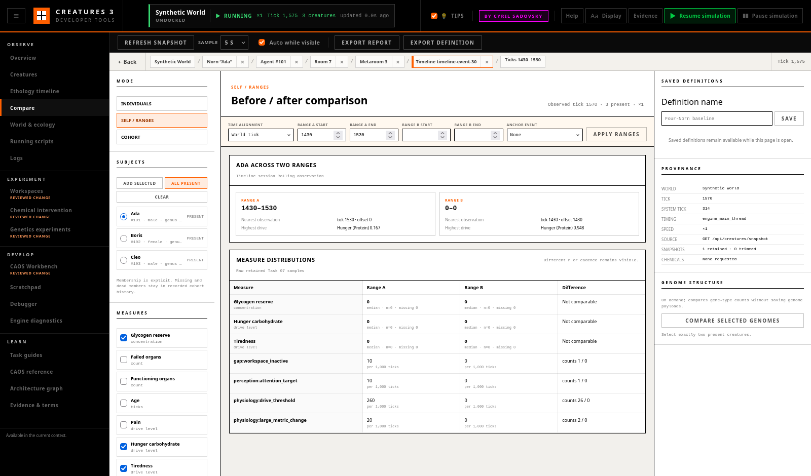

# Creature and Cohort Comparison

The **Compare** workspace puts creature states, retained time ranges, and
cohort distributions beside one another without treating an average as a
normal or healthy target. Comparisons are descriptive observations. They do
not establish that a treatment caused a change.

## Choose Subjects and Measures

Open **Creatures**, select a creature, and choose **Compare**. **Add selected**
uses the shared world-qualified selection; no agent ID needs to be copied.
**All present** creates an explicit cohort from the current coherent bulk
snapshot. A creature that later dies or disappears remains in the retained
cohort history as dead or missing rather than silently reducing `n`.

The measure picker includes glycogen reserve, functioning and failed organ
counts, tick age, and selected drives. Chemicals pinned in the Biological
Monitor also appear and are requested from the bulk snapshot, up to 16
chemical IDs. Values retain their engine units; no composite health score or
recommended target is calculated.

**Refresh snapshot** works even when **Auto while visible** is disabled.
Automatic sampling occurs only while Compare is visible and retains at most
180 coherent snapshots in browser memory.

## Individuals

Select two or more creatures for a same-tick difference table:

- identity, sex, genus/species, age stage, tick age, and life state;
- current attention target, motor attention/decision IDs, and action state;
- drives, glycogen, organ counts, and pinned chemicals;
- current room, retained movement distance and rooms visited;
- subject-qualified Timeline event rates per 1,000 world ticks.

All current-state columns come from one engine-main-thread bulk snapshot and
therefore show a tick offset of zero. The first creature is only a display
reference for deltas; it is not a target, rank, or claim of normality.
Movement and event rows state their different retained interval.

With exactly two present creatures, **Compare selected genomes** fetches their
live genome data on demand and displays only gene counts and gene-type/subtype
count differences. Saved definitions and reports do not embed genome bytes.

## Self and Before/After Ranges

Self comparison consumes retained **Timeline** and **Biological Monitor**
history. Record the subject in Timeline first, then select one creature in
**Self / ranges**.

Set Range A and Range B in world ticks, or select a retained intervention and
switch to relative time. Relative values are offsets from the intervention's
end tick; switching timebases converts the four displayed bounds. The result
shows:

- nearest retained atomic observation and its tick offset;
- highest drive in that observation;
- median, `n`, and missing count for each retained measure;
- event count and rate per 1,000 ticks for each range;
- a direct link back to the intervention evidence.

This supports a current/baseline, before/after, life-stage, or arbitrary
two-range comparison. Unequal sampling cadence is kept visible. A range with
no compatible retained samples says **Missing** or `n=0`; it is not filled
from another world, creature, or distant tick.

## Cohorts

Cohort mode reports explicit membership, present/missing/dead counts,
survivors, sex/genus/species/age-stage distributions, room occupancy, and the
recorded tick interval.

Every measure card is a small multiple showing:

- median and interquartile range (IQR);
- sample size `n` and missing count;
- min/max axis and one point per raw individual;
- IQR outliers, which can open that subject's retained Timeline;
- an expandable raw-individual table.

Movement has the same `n` and missing treatment and lists each subject's
distance and rooms visited. Distances are straight-line distances between
successive retained positions in pixels, so coarser accelerated sampling can
under-count a winding path.

**Observed arrivals** means a selected identity was absent from the first
retained cohort snapshot and appeared later. It is deliberately not called a
birth. Birth/death counts are shown only for explicitly labelled retained
Timeline lifecycle events. Current dead flags remain represented separately.

## Statistics and Missing Data

The median is the 50th percentile using linear interpolation between ordered
values. Q1 and Q3 use the same method at 25% and 75%; `IQR = Q3 - Q1`.
Outliers fall below `Q1 - 1.5 × IQR` or above `Q3 + 1.5 × IQR`.

`n` counts finite values for that measure. **Missing** includes selected
members without a finite value, including removed subjects retained in
history. A dead creature can still have a last observed value; its death and
presence status are shown independently. No value is compared across
materially different ticks without an offset or range label.

Event rates are counts divided by retained world-tick duration and multiplied
by 1,000. They describe the recorded interval and should not be read as
treatment effects.

## Saved Definitions and Exports

Name and **Save** a definition to reopen it after visiting other tabs during
the current page session. The definition stores:

- mode, world key, explicit subject keys, and selected measure IDs;
- timebase, ranges, and optional intervention event ID;
- schema version and creation time.

**Export definition** downloads that repository-safe configuration.
**Export report** adds current snapshot provenance, demographics, raw
individual distributions, and the caution that the comparison is
descriptive. Exports contain names, monikers, world names, and measurements
but no proprietary genome payload or game asset. Review them before sharing.

Definitions are browser-memory state, not changes to the world or save file.
World switches and tick regressions start isolated cohort histories.

## A Reproducible Four-Creature Review

1. Use a disposable world and inject the canonical two-male/two-female
   four-Norn cohort.
2. Select each subject or choose **All present** in Compare.
3. Keep normal speed long enough to collect several cohort and Timeline
   samples, then inspect raw distributions and room occupancy.
4. Record one subject in Timeline around a natural sleep/feeding episode or
   an explicitly recorded intervention.
5. Compare two ranges; confirm `n`, missing values, and nearest-observation
   offsets before interpreting a difference.
6. Run an accelerated interval and retain the coarser cadence warning.
7. Kill or remove only a disposable subject and confirm it remains in
   membership as dead or missing.
8. Save and reopen the definition, follow an individual/outlier to Timeline,
   return with **Back**, and export the report with provenance.

Prefer “median hunger was lower in the later retained range” over “the
treatment cured hunger.” The latter is a causal claim this workspace does not
establish.
