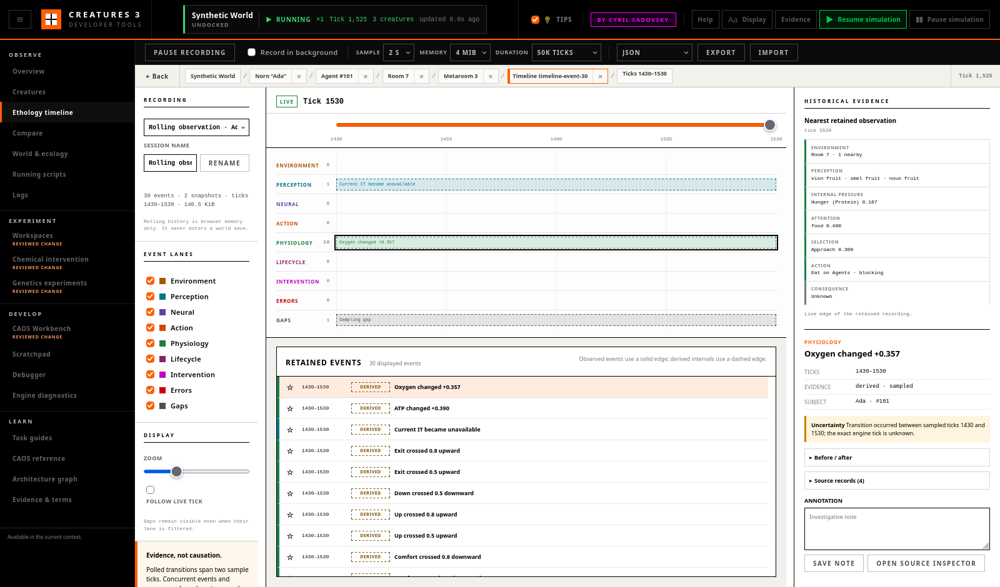

# Ethology Timeline

The **Timeline** workspace records a bounded history for one selected creature
and makes the order of environmental, neural, scripted, and physiological
observations inspectable. It is designed for evidence review, not automatic
storytelling: a sequence can suggest what to inspect next, but it does not
prove why a creature acted.

## Start a Recording

1. Select a creature in **Creatures**.
2. Open **Timeline**. A rolling recording begins at the chosen 1, 2, or 5
   second wall-time interval.
3. Keep **Follow live tick** enabled to stay at the newest retained sample.
4. Optionally name the session and choose a memory or tick-duration bound.

By default, polling occurs only while Timeline is visible. **Record in
background** explicitly continues it while another workspace is open. **Pause
recording** stops timeline sampling without pausing the simulation; the
pause/resume boundaries remain visible as gap markers.

The default buffer retains at most 3,000 events, 600 atomic observation
snapshots, about 4 MiB, and 50,000 world ticks. The first applicable bound
wins. The summary reports trimmed records and the earliest still-retained
tick. Bookmarks are preserved preferentially, but the hard memory bound always
wins.

Recordings live only in browser memory. They are not written into proprietary
world saves.

## Event Lanes

| Lane | Examples | Main sources |
|---|---|---|
| Environment | Room or metaroom transition | Atomic creature observation |
| Perception | Attention winner or current `IT` changed | Attention lobe and target handle |
| Neural | Decision winner changed | Decision lobe |
| Action | Creature script first observed, blocked, resumed, or no longer observed | Owning creature CAOS VM and structured log |
| Physiology | Highest drive, threshold crossing, large pinned signal, reward/punishment pulse, organ impairment | Atomic drives plus main-thread chemistry/organ status |
| Lifecycle | Life state or age stage changed | Life faculty in the atomic observation |
| Intervention | Reviewed chemical change or another explicit user action | Shared Observatory intervention ledger |
| Errors | Subject-correlated structured engine errors | Bounded structured Log stream |
| Gaps | Sampling delay, recording pause, disconnect, simulation boundary, or world/creature switch | Recorder lifecycle |

Filters hide ordinary lane events but never hide gaps. A gap is missing
evidence, not evidence that the creature was inactive.

The recorder compares successive samples in a pure reducer. A polled change is
**Derived** and spans both sample ticks: “between tick 100 and tick 120,” not
“at tick 120.” Its detail includes the sample interval, before/after values,
subject, related agents, uncertainty, and both source references. An explicit
main-thread event is **Observed**, can have an exact tick, and replaces an
overlapping weaker derived event in the same category.

## Scrub, Zoom, and Inspect

Drag the tick scrubber to leave the live edge. The mode changes from **Live**
to **Historical**, and the right column reconstructs the nearest retained
seven-stage observation. The exact retained snapshot tick remains visible
when it differs from the cursor. **Return to live** selects the newest live
session and resumes following.

Zoom controls the visible tick span. Long views use display-only aggregates;
exports still contain every retained event. Explicit events, bookmarks, and
gaps are never discarded merely to satisfy the display count.

Select an event to inspect:

- exact tick or sampled tick interval;
- Observed or Derived evidence;
- subject and related agent IDs;
- uncertainty and sampling language;
- before/after JSON;
- raw source records;
- intervention correlation ID;
- bookmark and free-text annotation.

**Open source inspector** carries the world-qualified creature and source
selection to Brain, Scripts, Log, Creatures, or Debugger. The shared **Back**
control restores Timeline, its historical cursor, and the selected event.

## Accelerated, Paused, and Disconnected Worlds

The timeline continues sampling while the engine is paused, so the retained
atomic snapshot can be inspected at the stable tick. Simulation pause/resume
markers are independent from recording pause/resume markers.

At accelerated game speed, the same wall interval spans more world ticks. The
workspace warns when this is likely to miss short actions; select 1 second for
finer resolution. A faster interval reduces, but cannot eliminate, polling
uncertainty.

Failed requests and API disconnects create visible gap markers. On world or
creature switch, the previous recording receives a boundary and the new
world-qualified subject starts a separate session. A world tick regression
starts a new epoch even when names and numeric agent IDs repeat.

## Export and Offline Review

Use **Export** to download the selected session:

- **JSON** is readable, versioned, and reloadable.
- **JSONL** separates metadata, events, and snapshots and is reloadable.
- **CSV event table** is convenient for analysis and includes provenance,
  before/after values, sources, related agents, and correlation IDs. It does
  not contain reconstructable snapshots and cannot be imported.

**Import** accepts version 1 JSON or JSONL. Imported sessions are labelled
**Offline**, remain separate from live sessions, and reconstruct their
historical observation without an engine connection. Imports are read-only
recordings, although event bookmarks and annotations can still be added in
browser memory.

Exports contain observations and identifiers, not proprietary sprites,
genomes, or world-save assets. They can still contain creature names,
monikers, world names, annotations, and raw log text, so review a file before
publishing it.

## Review an Evidence-Based Episode

For an eating, sleeping, approach, speech, or interaction episode:

1. Use normal speed and a 1-second interval when practical.
2. Find the attention/`IT` and decision changes before the action interval.
3. Open the Action source and confirm the owning creature script/event.
4. Inspect drive, pinned chemistry, reward/punishment, and organ events at
   their own sampled intervals.
5. Look for room changes, intervention markers, errors, or gaps that weaken
   the sequence.
6. Bookmark the decisive records and annotate the interpretation separately
   from the evidence.
7. Export JSON or JSONL so the displayed sequence and retained snapshots can
   be reviewed offline.

Prefer wording such as “an Eat script was first observed between ticks 100
and 120, followed by a sampled hunger decrease between ticks 120 and 140.”
Do not convert that into “the creature ate because it was hungry” without
additional, explicitly labelled inferential support.
