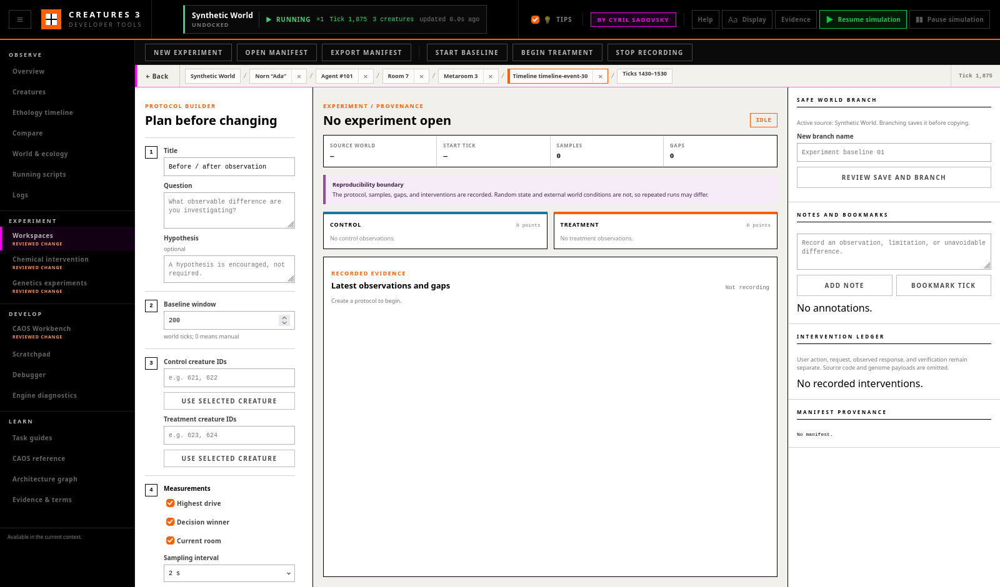

# Experiment Workspaces and Provenance

The **Experiments** workspace turns a live investigation into a portable
protocol, an explicit before/after recording, and a provenance ledger. It is
designed to make an experiment inspectable, not to claim that Creatures can be
replayed deterministically.

The workspace stores a browser draft for convenience. That draft is not the
durable scientific record: export the JSON manifest before closing the tools
or moving to another machine.



The screenshot shows a completed disposable-world run. Control and treatment
remain in separate cards and rows; the purple gap is a real engine
disconnection rather than interpolated data; the right panel preserves notes,
bookmarks, branch status, and verified mutations.

## What the Manifest Records

Experiment manifest schema version 1 contains:

- title, question, and optional hypothesis;
- source-world name and type as a local reference;
- configured engine source identifier, game build identifier, and sanitized
  launch options;
- initial world/system tick, wall time, pause state, and game speed;
- baseline and treatment phases;
- distinct control and treatment subjects;
- measurements, cadence, planned intervention, duration, and stopping
  condition;
- observations, explicit recording gaps, notes, and bookmarks;
- mutating Developer Tools requests and their observed responses;
- world-branch references and export history;
- reproducibility and export limitations.

Every observation has a world tick or an explicit reason why the time was
unavailable. A missing interval is a gap with `interpolated: false`; the
workspace never invents intermediate evidence.

## Create a Minimal Before/After Experiment

1. Use an isolated game-data copy and load a disposable world. If the active
   world matters, create a branch before intervention.
2. Select a creature elsewhere in the tools. In **Experiments**, add that
   creature to either **Control** or **Treatment**. A subject cannot occupy
   both arms.
3. Enter the question. Add a hypothesis only if one is useful.
4. Choose the baseline window, measurement set, sampling interval, planned
   intervention, treatment window, and stopping condition.
5. Mark the world disposable/branched only when that is an explicit fact.
6. Select **Create browser draft**, then **Start baseline**.
7. Wait for the baseline window. Select **Begin treatment** and make the
   planned change in the appropriate tool.
8. Add notes or bookmarks at relevant ticks. Stop manually, or allow the
   configured treatment duration to stop the recorder.
9. Select **Export manifest**. Reopen the file with **Open manifest** to verify
   the protocol, labels, ticks, gaps, and ledger.

Recording continues while another tab is open because starting an experiment
is an explicit background-recording action. It stops on cancellation, on a
world switch, or at the treatment duration. Closing the page writes an
explicit browser-close gap to the local draft; it cannot keep sampling after
the page is gone.

## Baseline, Control, and Treatment

**Baseline** is the before-intervention phase in one run. **Control** and
**Treatment** are subject roles. They are separate dimensions:

- a control subject can have baseline and treatment-window observations while
  remaining untreated;
- a treatment subject can have the same measurement cadence before and after
  the intervention;
- the two arms remain separate in the UI and JSON export;
- repeated trials should use separate exported manifests and record
  unavoidable differences between runs.

The workspace does not calculate a causal or statistical conclusion. A
difference is recorded evidence; whether it supports a hypothesis remains an
investigator judgment.

## Safe World Branches

**Review save and branch** performs a collision check, then opens a
confirmation dialog showing the active source and requested branch name. On
confirmation, the engine:

1. verifies that the named source is still active;
2. rejects `Startup`, invalid names, the active name, and any existing world;
3. saves the active source world;
4. copies its directory under the new name;
5. verifies that the copied world archive exists;
6. leaves the new branch unloaded.

The operation never overwrites an existing world and never deletes a world as
cleanup. If a low-level copy fails, the result names the failed stage; inspect
the local Worlds directory before reusing that name. Select **Load branch**
only after creation succeeds. The session ribbon must confirm the loaded
branch before recording starts.

Branch references in the manifest are names and status only. World archives
are proprietary local content and are never embedded in the export.

## Intervention Ledger

A redacting transport observer records mutating same-origin `/api` requests
while an experiment is active. Each entry keeps four concepts separate:

- **user action** — the operation the user initiated;
- **requested operation** — HTTP method/endpoint and safe parameters;
- **observed result** — the endpoint response or network failure;
- **verification** — pending, verified, failed, or unavailable, with method.

Pause, resume, speed, save/load/branch, CAOS execution, script changes,
debugger stepping, chemical changes, and genetics operations are eligible.
Generated CAOS bodies and scriptorium source are represented by a short first
statement and byte length. Genome/gene payloads are omitted. The narrow
chemical-intervention request retains creature ID, raw chemical ID, operation,
reviewed concentration/tick, baseline status, and requested value; its observed
result retains the engine-confirmed before/after concentrations and tick.

An HTTP success is not automatically treated as independent verification.
Pause/speed results, the branch archive check, and engine-returned chemical
before/after values can be marked verified by their narrow endpoints; other
operations remain pending until a later task or manual observation supplies
an independent check.

## Disconnection, Pause, Cancellation, and Shutdown

- Engine disconnection opens a visible gap. Reconnection closes it and
  sampling resumes without interpolation.
- Pausing the simulation does not stop the recorder. Repeated points may share
  the same world tick and retain their wall times.
- A world switch during recording cancels the run and preserves the gap and
  existing evidence.
- **Stop recording** does not pause or resume the engine.
- Closing the page cannot complete a pending engine operation. Export before
  shutdown and confirm the session ribbon is running at normal speed.

## Export and Reopen

**Export manifest** writes formatted JSON with:

```json
{
  "kind": "creatures3_observatory_experiment",
  "schemaVersion": 1,
  "exportPolicy": {
    "proprietaryWorldsEmbedded": false,
    "genomesEmbedded": false,
    "creaturesEmbedded": false,
    "savesEmbedded": false,
    "assetsEmbedded": false
  }
}
```

Exports include observations and sanitized provenance, but not world
directories, saves, creature files, genome bytes, scripts, images, sounds, or
other proprietary game assets. Local asset references are labels only.

**Open manifest** accepts schema version 1 and a small legacy draft version 0
migration. Unknown versions produce an explicit unsupported-version error.
Imported manifests are offline review records and cannot resume live
recording.

## Reproducibility Limitations

A saved or branched world is a useful baseline, not a bit-for-bit replay
guarantee. The manifest does not capture complete engine random state, OS
timing, external clients, network input, every world agent condition, or
proprietary assets. Sanitized launch options omit local paths. State these
limitations when sharing results.
