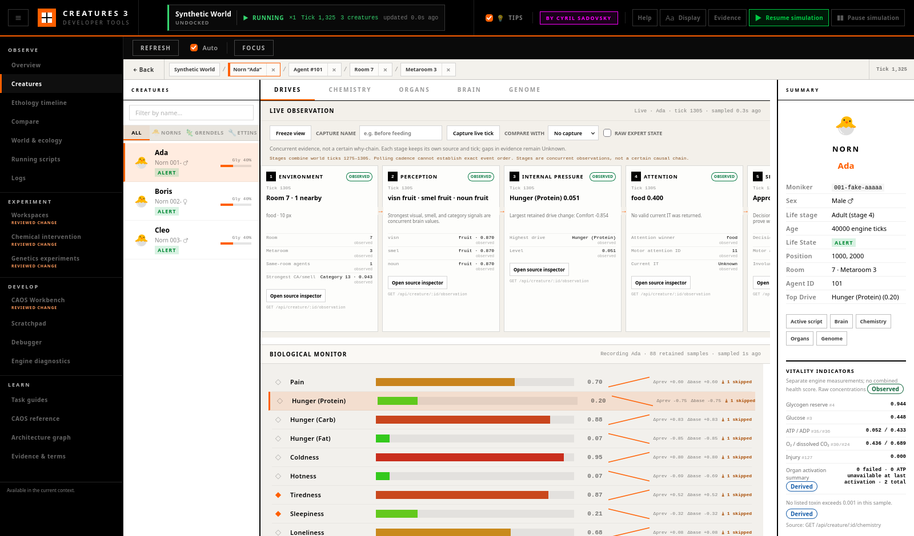

# Following One Creature Live

The **Live Observation Strip** follows one selected creature through seven
concurrent evidence views. It helps answer “what was observable at this
tick?” without turning correlation into a fictional causal story.

## The Seven Stages

1. **Environment** reports the creature's room, metaroom, same-room agent
   count, and up to five nearest same-room agents.
2. **Perception** reports available winners from the visual, smell, and noun
   lobes. A genome may omit one of these lobes; the stage remains present and
   reports what is actually available.
3. **Internal pressure** reports the highest current drive. When retained
   drive samples exist, it also names the largest adjacent-sample change.
4. **Attention** reports the attention-lobe winner, the motor attention ID,
   and the current `IT` agent when valid. `IT` is an observed engine handle,
   not proof of subjective intent.
5. **Selection** reports the decision-lobe winner, current motor action
   offset, and any involuntary action. A decision winner is not a guarantee
   that a matching CAOS script will run.
6. **Action** reports the owning creature agent's CAOS VM state, installed
   script classifier/event, mapped source statement, blocking command,
   `TARG`, and the script's initial `IT` when available. “Idle” means that no
   creature script was running at capture time; it does not mean that the
   creature intended to do nothing.
7. **Consequence** lists the largest changes between adjacent retained drive
   or pinned-chemical samples. This stage is Derived. Its timing may overlap
   an action, but timing alone does not establish cause or even prove that the
   change is a consequence of that action.

Each stage stays in the strip when evidence is unavailable. **Unknown** is a
result, not an invitation for the interface to guess.

## Time and Evidence

Environment through Action are captured by
`GET /api/creature/:id/observation` in one engine-main-thread work item. They
share a world tick, system tick, wall capture time, pause state, speed, and
world name. Consequence consumes the bounded Biological Monitor history and
therefore carries its own source and tick.

The strip always shows the tick and evidence level on every card. It warns
when stage ticks differ, when retained data has a coarser cadence, or when
data is stale. Its permanent causal warning is deliberate: the arrows express
an investigation order, not a proven biological pipeline.

Neural competition is shown when a recorded winner has activity below 0.2,
the closest available alternative is within 0.05, or another sampled neuron
currently has stronger activity. This is a Derived comparison of observed
activities, not a confidence score.

## Freeze, Capture, and Compare

**Freeze view** freezes only the display. The engine keeps running, endpoint
polls continue, and **Resume live view** jumps to the most recent sample.
Use the global engine Pause control when the world itself must stop.

To preserve an observation:

1. Optionally type a short name such as `approach before lift`.
2. Select **Capture live tick**. A capture always uses the newest live sample,
   even if the display is frozen.
3. Continue observing or freeze another interesting tick.
4. Choose the capture under **Compare with**.

Each stage then reports **Changed** or **Unchanged**. Captures are immutable,
limited to 20, and isolated by world and creature. Switching creature,
loading another world, or regressing the world tick clears them so numeric
agent IDs cannot leak across sessions.

## Source Navigation

The source control on a card preserves the selected creature and opens the
nearest detailed workspace:

- Perception, Attention, and Selection open the Brain sub-tab.
- Internal pressure opens Drives.
- Consequence opens Drives or Chemistry according to its strongest change.
- Action opens Scripts filtered to the owning agent and observed script
  classifier. **Open owning agent** opens that agent in Debugger.
- **Open current IT** opens the exact observed target in Debugger.
- Environment preserves room and metaroom context. Until the dedicated World
  workspace is available, it remains in the Creatures workspace.

Browser Back restores the previous Observatory context. Navigation is
world-qualified and is rejected if its target belongs to a different active
world.

## A Careful Observation Workflow

Select one creature, keep the engine at normal speed, and watch several
samples before naming a behavior. For an approach, inspect the observed
same-room agents, current `IT`, decision winner, action event/source, and
subsequent drive changes at their own ticks. Apply the same method to eating,
sleeping, speech, or an idle VM. Record what each source shows:

- “Current `IT` is food” is supported when the Attention card reports that
  target.
- “The decision winner is Get” is supported when Selection reports it.
- “A Get script is running” requires the Action card; Selection alone is not
  enough.
- “Hunger decreased after the sample” is a Derived retained-series
  observation.
- “The creature ate because it was hungry” is an inference that the strip
  does not establish.

Use **Raw expert state** when a friendly label hides an important distinction.
It reveals each stage's exact JSON source without changing the observation.

## Availability and Failure Behavior

Polling occurs only while the Creatures workspace is active, a creature is
selected, and the strip is open. Its interval follows the Biological Monitor
setting (1, 2, or 5 seconds). Closing the strip stops this endpoint's polling.

Disconnected endpoints, missing lobes, an invalid `IT`, unresolved map
geometry, or fewer than two retained biological samples produce explicit
Unknown stages. They do not hide a stage or reuse data from a previous
creature. A stale warning appears after twice the configured interval without
a fresh successful sample.

The endpoint returns at most five nearby agents and marks truncation; the
same-room count remains complete. It also reports all 20 current room
CA/smell-channel values with category labels where the world supplies a
mapping. It is an observation aid rather than a complete sensory simulation.
