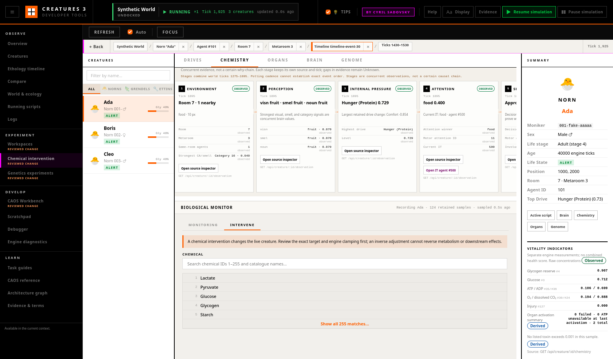

# Safe Chemical Interventions

The Creatures **Chemistry → Intervene** workspace changes a selected live
creature without requiring CAOS. It makes the numeric operation reviewable,
binds it to a fresh world and creature identity, and records what the engine
actually observed.



This is an experimental mutation tool, not a treatment recommender. A chemical
name is a catalogue label for a raw identifier. One concentration cannot
diagnose a creature, and a later inverse adjustment cannot reverse metabolism,
learning, movement, or other downstream effects.

## Concentration, dose, and target

These terms are deliberately distinct:

| Term | Meaning |
|---|---|
| Chemical identifier | Raw engine slot `1`–`255`. Slot `0` means “none” and cannot be changed here. |
| Concentration | Observed value currently stored in the slot, in the engine range `0`–`1`. |
| Adjustment or dose | Signed change added to the current concentration, from `−1` to `+1`. |
| Target concentration | Absolute value to set, from `0` to `1`. |
| Immediate projection | Derived numeric result for the sampled concentration using the engine's clamping rules. |
| Applied change | Engine-confirmed `after − before`; this can differ from the requested dose when clamped. |

For an adjustment, the preview calculates:

```text
projected = clamp(sampled concentration + requested dose, 0, 1)
```

A target operation uses the requested value directly. The projection is not a
forecast of biochemistry or behaviour after subsequent ticks.

## Safety preconditions

Before applying a reviewed operation, the engine independently verifies:

- active world name still matches the reviewed world;
- the numeric agent ID still belongs to the same creature moniker;
- the chemistry sample is no more than 200 world ticks old;
- the sampled concentration is still within `0.01` of the current value;
- chemical ID, operation, and numeric range are valid; and
- an unusual change over `0.25`, or any clamped adjustment, received explicit
  confirmation.

If any check fails, nothing is applied. Refresh the target and review again.
The Apply button also remains pending until its one request completes, which
prevents accidental duplicate submissions.

The endpoint runs the operation on the engine main thread and uses **Preserve**
pause behavior. A paused world stays paused; a running world stays running.
The tool never silently resumes a world.

## Observe before and after

The composer pins the selected chemical for retained biological sampling.
**Capture baseline** refreshes chemistry and sets the current biological-series
sample as the comparison baseline. The ledger records one of:

- `manual_baseline`;
- `experiment_baseline_completed`; or
- `skipped`.

In an active Experiment baseline, selecting the chemical automatically pins
and captures it. The composer refuses to mutate during that baseline phase:
use **Begin treatment**, then apply the planned intervention. A protocol preset
is available when the experiment's planned-operation text uses the explicit
form:

```text
chemical 35 adjust +0.05
chemical 35 target 0.50
```

After success, the browser requests immediate and short follow-up chemistry
samples. Normal active-workspace polling continues drives, attention/decision,
behaviour, pinned signals, and available organ readings. A magenta marker is
attached to the selected chemical series and the Timeline intervention lane at
the engine-returned operation tick.

## Perform a small recorded intervention

Use an isolated disposable world or a world branch:

1. Open **Creatures**, select the exact creature, then open
   **Chemistry → Intervene**.
2. Search by raw chemical ID or catalogue name and select a slot from `1` to
   `255`.
3. Confirm the creature identity, moniker, current concentration, sample tick,
   freshness, and pause behavior.
4. Choose **Capture baseline**. Observe several normal-speed samples if the
   question requires a baseline window.
5. Choose **Small +0.05** or **Small −0.05**, or enter a justified custom
   adjustment/target.
6. Read the equation and clamping warning. Select **Review intervention**.
7. In the final dialog, recheck the creature, chemical, operation, immediate
   projection, reviewed tick, pause behavior, and baseline record.
8. For an unusual or clamped operation, select the explicit confirmation.
   Then choose **Apply reviewed intervention** once.
9. Read the engine-confirmed before value, after value, applied change, tick,
   and pause state. Inspect the pinned graph and **Timeline** marker, and keep
   observing the follow-up window.
10. In **Experiments**, inspect the ledger request and observed result. Export
    the manifest if the protocol must be preserved.

## Result and recovery

The result card reports engine-confirmed values. **Prepare inverse adjustment**
only fills a new reviewed adjustment equal to the negative applied change. It
is intentionally not called Undo: time may have advanced and the original
biological state may no longer be recoverable.

For genuine experimental recovery, load a known baseline world or create and
use a safe branch before treatment. Do not assume that returning one chemical
slot to a previous number restores the creature.

## Failure and disconnect behavior

- Missing or reused creature ID: rejected before mutation.
- Changed world: rejected before mutation.
- Old or changed sample: rejected; refresh and review.
- Creature removed after review: rejected.
- Disconnect during submission: the browser does not assume success. Refresh
  chemistry and inspect the experiment ledger/API records before retrying.
- Timeout or malformed response: shown as Not applied/unknown outcome; no
  automatic retry occurs.

See [Creatures](tab_creatures.md),
[Biological Monitor](tab_creatures.md#biological-monitor),
[Ethology Timeline](ethology_timeline.md), and
[Experiment Workspaces](experiment_workspaces.md) for the surrounding
observation and provenance model.
