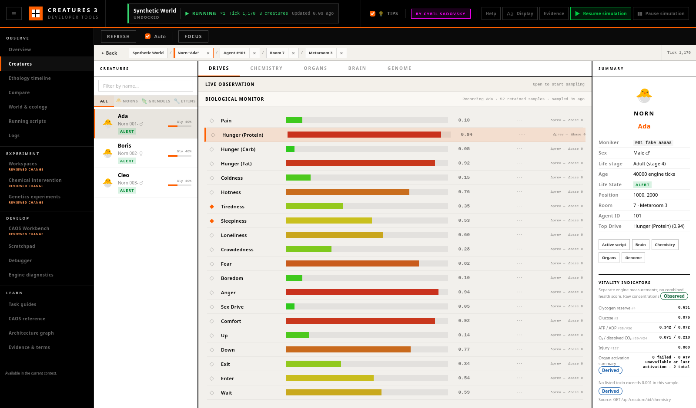

# Creatures Tab

The **Creatures** tab is a comprehensive, live inspector for all creature agents (Norns, Grendels, Ettins) currently active in the world. It provides sampled drive levels, biochemistry, organ state, and neural activity without inventing an overall health score.

See [How to Read Biological Labels](biological_labels.md) for the shared rules
behind observed, derived, inferred, and unknown biological labels.

## Interface Layout

The interface uses a three-panel design:
1. **Creature List (Left Sidebar):** A list of all active creatures.
2. **Detail Panel (Center):** The main content area displaying in-depth tabs (Drives, Chemistry, Organs, Genome, Brain).
3. **Summary Card (Right Sidebar):** At-a-glance information for the selected creature.

### Toolbar Controls
* **Refresh:** Manually fetch the latest data from the engine.
* **Auto:** Toggle automatic polling while the Creatures workspace is active.
  The Biological monitor interval controls whether this is every 1, 2, or 5
  seconds.
* **Focus:** Instantly snap the in-game camera to the selected creature's coordinates.

### Creature List
* Lists all creatures with their species icon (🐣 Norn, 🦎 Grendel, 🔧 Ettin).
* Displays the creature's name (or genus + moniker), life state badge (alert, asleep, unconscious, dead), and a compact **Gly** bar for glycogen reserve (chemical 4).
* **Search & Filters:** Use the text box to search by name/moniker, and the
  **All / 🐣 Norns / 🦎 Grendels / 🔧 Ettins** toggles to filter by genus. Both
  combine: selecting Norns and typing a name shows only Norns matching it.
* Selecting a creature publishes its world-qualified moniker, agent ID and
  classifier, room, and metaroom to the shared context. The summary's
  **Active script**, **Brain**, **Chemistry**, **Organs**, and **Genome**
  actions follow that subject without copying an ID.

---

## Live Observation Strip

The open strip above the biological monitor places seven simultaneous views
of the selected creature side by side: **Environment**, **Perception**,
**Internal pressure**, **Attention**, **Selection**, **Action**, and
**Consequence**. It is an evidence navigator, not a claim that each card
caused the card to its right.

The first six cards come from one main-thread engine sample and therefore show
the same world tick. Consequence is derived from adjacent retained biological
samples and may have a different tick. Every card states its evidence level,
source, and tick; missing lobes, targets, samples, or geometry remain visible
as Unknown. Weak, close, or apparently overtaken neural winners expose the
strongest competing value rather than presenting a brittle decision as
certain.

**Freeze view** holds the rendered sample while the world and live polling
continue. **Capture live tick** stores a named, immutable sample, and
**Compare with** labels each stage Changed or Unchanged against it. **Raw
expert state** reveals the exact stage payload. Source buttons open the
relevant Brain, Drives, Chemistry, or Debugger view, while **Open current IT**
hands the observed target to Debugger using its identity fields.

See [Following One Creature Live](live_creature_observation.md) for the
complete reading guide, limitations, capture workflow, and Firefox-tested
examples.

---

## Biological Monitor

The collapsible monitor above every biological sub-tab retains changes rather
than only displaying the latest response. It records all drives, selected
vital/reinforcement chemicals, pinned chemicals, organ values while Organs is
visible, and the state variables of the selected neuron while Brain is
visible. Detailed chemistry, organ, and neural endpoints are requested only
for the selected creature and relevant visible view.

### Stable ordering and pins

The order selector is explicit and remains in its chosen mode:

* **Canonical ID** orders drive, chemical, organ, and state identifiers
  consistently. This is the default; chemistry no longer jumps into a new
  position after every poll.
* **Functional group** uses energy/metabolism, respiration,
  digestion/reserves, drives/backups, immunity, smell/environment,
  reproduction, stress/injury/toxins, sleep/reinforcement, organ, and neural
  groups. These are navigation aids, not claims that a chemical has only one
  biological function.
* **Current value** and **Absolute Δprev** intentionally re-rank on new
  samples because the user explicitly selected a changing order.
* **Pinned order** places pinned signals first. The up/down controls in the
  tray define their persistent relative order.

The hollow diamond on a row pins it. Filled diamonds identify pinned signals.
ATP, oxygen, injury, reward, punishment, tiredness, and sleepiness begin in
the tray so vital, reinforcement, and sleep signals are discoverable.

### Reading trends and deltas

Every retained row can display an unsmoothed sparkline plus two different
deltas:

* **Δprev** is current value minus the immediately previous retained sample.
* **Δbase** is current value minus the sample at or immediately before the
  tick chosen by **Set baseline now**.

Hover a sparkline point for its exact world tick, raw value and unit. The
sparkline tooltip reports retained sample count, minimum, maximum, and rate
per 100 world ticks. A magenta point is a recorded intervention, such as a
reviewed chemical adjustment; hover it for its type, tick, and provenance. The line
is not smoothed, and visual co-movement is correlation rather than evidence of
cause.

Concentration, rate, and change are not interchangeable. Chemical values use
raw engine concentration, drives use raw drive level, organ rows preserve the
endpoint's raw/rate/cost meaning, and neural rows use raw neuron state. A delta
has the same unit as its signal; the displayed rate is change per 100 world
ticks.

### Sampling, retention, and stale data

Recording defaults to a 2-second wall interval and can be changed to 1 or 5
seconds. World tick is the primary biological timebase; wall/system time,
pause state, speed, interval, source endpoint, and evidence level accompany
every sample.

* A paused simulation retains one changed state at a tick, then suppresses
  identical repeated polls.
* A warning reports skipped expected intervals. Accelerated simulations
  therefore make their coarser observation coverage visible instead of
  pretending every tick was sampled.
* A stale warning appears after twice the configured interval without a
  successful sample.
* Each series retains at most 300 samples, and the shared store retains at
  most 60,000 samples. Drop counts remain visible and exportable.
* Long ranges use a min/max envelope downsampler that preserves the first,
  last, and extrema; exported samples remain unsmoothed.
* Creature identity uses its moniker when available. Creature switches,
  world names, and regressed world ticks create isolated sessions rather than
  merging unrelated histories.

**Export JSON** writes schema version 1 with the session/world/subject
identity, baseline tick, pinned IDs, metric metadata, drop counts, complete
retained sample metadata, gaps, and intervention markers. The storage/render
split is also consumed by the Timeline workspace and is available to the
future Comparison workspace.

### A careful investigation workflow

Pin one drive, chemical, organ value, or neural state; set a baseline; observe
several normal-speed samples; then record the exact tick of an intervention.
Keep observing after the first response—an instantaneous chemical change is
not necessarily the final biological consequence. Compare related signals
without treating timing alone as proof of mechanism, and consult the
biochemistry, organ, or brain detail when interpreting a correlation.

---

## Drives Sub-Tab

Provides a visual breakdown of the creature's immediate motivations.

> **Deep Dive:** For the complete drive system architecture — all 20 drives, the three-layer locus system, the stimulus pipeline, reinforcement learning, and instinct processing — see [Drives & Reinforcement Learning](drives_and_learning.md).

* Displays 20 horizontal bars for all creature drives (Pain, Hunger, Tiredness, Sex Drive, etc.).
* Uses a colour gradient: green (low) → yellow (mid) → red (high).
* The highest active drive is highlighted with an orange accent border.
* Numeric values, pins, explicit deltas, and retained sparklines are displayed
  alongside each bar.

Drives are observed engine values. A high drive is a motivational signal, not
proof of intent or a deterministic explanation for the next action.

---

## Chemistry Sub-Tabs

The Chemistry inspector is split into two distinct modes: **Monitoring** and
**Intervene**.

> **Deep Dive:** For the complete chemical ID table (all 256 chemicals with names and functions), the organ update loop, receptor/emitter algorithms, and a worked digestion example, see [Biochemistry & The Chemical Simulation — Deep Dive](biochemistry_deep_dive.md).

### Monitoring Mode
* Displays all 256 biochemical concentrations as colour-coded bars.
* Defaults to stable canonical chemical ID order; other explicit order modes
  are available in the Biological monitor.
* Includes a "Non-zero only" toggle to hide inactive chemicals.
* Features a full repository of all 256 biochemicals, mapped directly from the engine's internal dictionary and the historical GameWare Chemical List.
* Colour-coded by category: purple (drives), red (antigens), orange (antibodies), green (smells), blue (general).
* Activate a chemical row to make that chemical the primary context while the
  selected creature remains related.
* Pinned and vital chemicals retain trends. Unpinned chemicals continue to
  show their current concentration without consuming a full history.

### Safe Chemical Interventions

**Intervene** replaces the raw Syringe action with a reviewed mutation
workflow:

* Search all 256 raw identifiers and catalogue labels; chemical `0` remains the
  reserved “none” slot and cannot be changed.
* Inspect the exact live creature/moniker, current observed concentration,
  sample tick/freshness, and current pause behavior.
* Choose a signed adjustment, absolute target, small ±`0.05` preset, or an
  explicitly formatted Experiment protocol value.
* Preview the immediate `0`–`1` engine result and any clamping before opening
  the final confirmation dialog.
* Capture a manual baseline, or use the automatically pinned Experiment
  baseline before beginning treatment. Skipping baseline remains possible and
  is explicit in the ledger.
* Submit through the narrow main-thread endpoint. It rechecks world, creature
  moniker, sample age, sampled concentration, and unusual-amount confirmation.
* Read engine-confirmed before/after values and the operation tick. The
  chemical graph and Timeline receive a marker at that tick, and Experiment
  provenance retains the raw chemical ID.

The endpoint preserves the current pause state and prevents duplicate
submission. The result offers **Prepare inverse adjustment**, never “undo”:
metabolism and downstream effects may already have changed. See
[Safe Chemical Interventions](safe_chemical_interventions.md) for the
step-by-step workflow, protocol syntax, recovery boundary, and failure states.

---

## Organs Sub-Tab

Provides deep insight into the biological machinery keeping the creature alive.

* Lists all of the creature's organs as expandable cards.
* Each card has the stable identity **Organ N**. It does not assume a mammalian-organ mapping.
* A **Likely role** is explicitly marked **Inferred** and lists the chemicals supporting the chemical-participation heuristic. Unmatched organs remain **not classified**.
* Each card shows a derived long-term life-force ratio, an observed status badge (ATP AVAILABLE / ATP UNAVAILABLE / FAILED), and component counts (Receptors, Emitters, Reactions). ATP availability is the flag from the organ's most recent activation, not a diagnosis.
* **Expanding an organ** reveals:
  * **Stats Grid:** Pin-able Clock Rate, Energy Cost, Life Force, Rate of
    Repair, and zero-ATP damage values with trends and deltas.
  * **Reactions:** Chemical formulas with proportions and visual reaction-rate bars (e.g., `Glucogen + 4 ASH2Dehydrogenase → Starch`).
  * **Receptors:** Target locus, binding chemical, threshold, gain, and effect flags.
  * **Emitters:** Target locus, emitted chemical, threshold, gain, and tick rate.

---

## Genome Sub-Tab

The Genome tab is a fully immersive, real-time binary parser for inspecting the root genetics data loaded into the creature. It maps exactly to the C++ binary structure of the `.gen` files.

* **Filtering & Search:** Filter genes by category (Brain, Biochemistry, Creature, Organ) or perform text searches against parameters.
* **Age Filter:** Isolate genes by their "switch-on" time (Baby, Child, Adult, Senile).
* **Intelligent Badges:** Gene cards present structural parameters like mutable/cuttable flags, gender targeting, and dormancy.
* **SVRule Translation:** Decompiles complex binary SVRule neuron setup structures into formatted, human-readable CAOS pseudo-code for Brain Lobes and Neural Tracts.

*(For full genetic modification and cross-breeding, use the dedicated [Genetics Kit](tab_genetics_kit.md). For the complete `dna3` format specification and all gene subtype layouts, see [The Digital Genome](genome_deep_dive.md).)*

---

## Brain Sub-Tab

The Brain tab provides a real-time spatial visualization of the creature's neural network, inspired by the original "Brain in VAT" tool.

> **Deep Dive:** For the full brain architecture — lobe processing rules, SVRule microcode, dendrite migration, and the instinct system — see [Brain & SVRules Deep Dive](brain_deep_dive.md).

### Spatial Heatmap
* **Genome anatomy** positions lobes at the exact coordinates returned by the engine.
* **Functional flow** visibly marks a transformed layout that aligns common sensory lobes around combination and moves the movement lobe below it.
* The active mode, evidence level, and transformation description remain visible above the canvas.
* **Neurons (Cells):**
  * **Dark/transparent:** Inactive. Faint inner boundaries maintain the grid.
  * **Bright orange:** Highly active (activity ≈ 1).
* **Winning Neuron:** The neuron with the highest activation in Winner-Takes-All (WTA) lobes is highlighted with an orange border and glow.
* **Noise floor:** a baseline visual noise floor of `0.07` is applied only to
  SV-rule-noisy lobes such as `noun` and `verb`, so low-activation WTA lobes
  stay visible without hiding tiny fluctuations elsewhere.
* Lobe names appear above each lobe in a darkened version of the genome colour,
  over a subtle dot grid that helps gauge distances.
* Zoom from 40% to 300% using the **−**, **+**, and **⟲** controls in the
  viewport corner or Ctrl/⌘+Scroll. Lobes, cells, tract lines, and labels
  re-render at the new scale.

### Neuron Inspection
* **Hover** over a neuron to see a tooltip with its lobe name, ID, semantic label, and all non-zero SVRule state variables (S1–S7).
* **Click** a neuron to open the **Deep Neuron Detail** panel:
  * Shows all eight SVRule state variables as visual bars (orange for
    positive, magenta for negative) that can be pinned into the shared
    monitor; the selected neuron's values continue sampling while Brain is
    visible.
  * Displays the neuron's Lobe initialisation/update SVRules and the Tract
    rules of every connected tract, decompiled into CAOS-like pseudo-code.
  * Lists tabular Dendrite Connections (incoming and outgoing) with weight
    bars, labels, and dormant markers.
  * Draws dormant zero-weight anatomical pathways as faint dashed white lines
    across the brain map, exposing innate wiring before reinforcement.
  * Click the neuron again to dismiss the panel and return to the lobe list.

### Tract Connection Lines
* Orange SVG lines connect lobes linked by neural tracts. Thickness indicates dendrite count.
* **Click** a tract line to fetch its dendrite data and draw individual neuron-to-neuron connections as magenta lines.

*Note: While the overall brain state is polled every 2 seconds while the Brain
sub-tab is visible, dendrite data is fetched **on-demand** only due to its
size. Switching creatures clears the view and loads the new subject.*

## Summary and Vitality Indicators

The summary separates life stage, tick age, and life state. Its **Vitality
indicators** show observed raw concentrations side by side: glycogen, glucose,
ATP/ADP, oxygen/carbon dioxide, injury, and listed toxins. The toxin-threshold
result and aggregate organ activation counts are derived and carry their own
evidence badges. There is deliberately no aggregate health percentage. Every
chemical indicator includes its raw chemical ID and concentration.

---

## See Also

* **[The Digital Genome](genome_deep_dive.md)** — Authoritative reference for the `dna3` binary format, gene header structure, all 19 gene subtypes, and the crossover/mutation algorithms.
* **[Brain & SVRules Deep Dive](brain_deep_dive.md)** — Complete neural architecture reference: lobes, tracts, neuron state variables, the 69-opcode SVRule instruction set, dendrite migration, and the instinct system.
* **[Drives & Reinforcement Learning](drives_and_learning.md)** — The complete motivational pipeline: 20 drives, 99 stimulus events, the reinforcement learning loop, instinct processing, and involuntary actions.
* **[Biochemistry Deep Dive](biochemistry_deep_dive.md)** — The full chemical simulation reference: 256-chemical ID table, organ architecture, receptor/emitter processing, reaction rate formulas, and the locus system.
* **[Genetics Kit](tab_genetics_kit.md)** — For full genetic modification, cross-breeding, and injection of new creatures.
* **[Debugger](tab_debugger.md)** — To inspect and step through the CAOS scripts driving creature behaviour.
* **[API Reference](api_reference.md)** — Endpoint documentation for
  creature observation, chemistry, safe intervention, organs, and brain.
