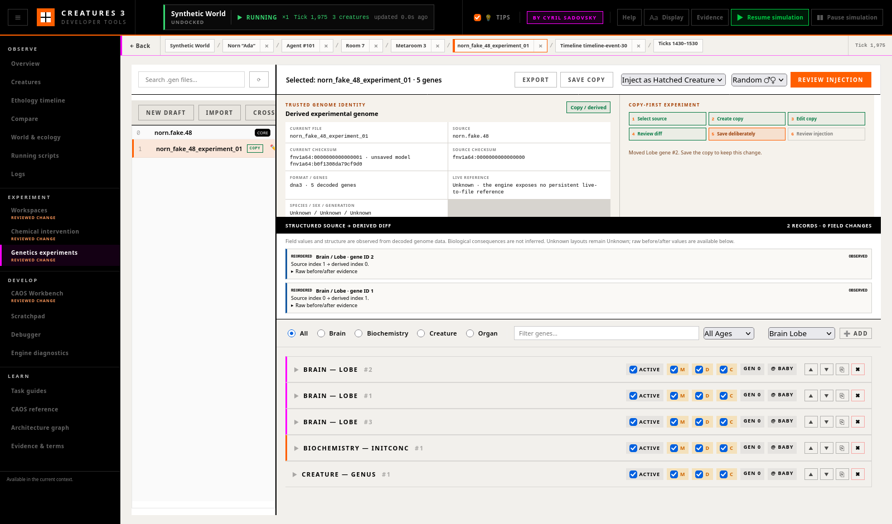

# Genetics Kit

The Genetics Kit is a copy-first workspace for inspecting genome identity,
editing a derived version, reviewing exact differences, and deliberately
introducing a saved version into a disposable or chosen branch world.

Originals are read-only in the ordinary workflow. The tool never needs to
delete a source in order to edit it, and no genome binary is embedded in
documentation, an experiment manifest, or Git.

## Read the identity before the genes

The **Trusted genome identity** panel distinguishes facts that the engine can
verify from metadata that is unavailable:

- **Current file** is the exact file selected in the engine Genetics
  directory.
- **Source** is the recorded origin of an experimental copy. A crossover also
  retains its second parent.
- **Current checksum** is an FNV-1a-64 digest of the saved binary bytes. An
  additional model checksum appears while browser edits are unsaved.
- **Source checksum** is captured when the copy or crossover is created and is
  checked again before save and injection.
- **Format / genes** reports the observed `dna3` format and decoded gene count.
- **Live reference** reports an engine-confirmed result from an injection made
  in the current browser session. Otherwise it stays **Unknown** because the
  engine exposes no persistent live-creature-to-source-file reference.
- **Species / sex / generation** stays **Unknown** unless a reliable live
  reference supplies the value. A filename is not treated as biography.

Library badges have narrow meanings:

| Badge | Meaning | Ordinary editing |
|---|---|---|
| `CORE` | A protected source has a matching `.gno` file | Read-only |
| no badge | An original source without experiment provenance | Read-only |
| `COPY` | A `.gxp.json` sidecar verifies this exact filename and binary checksum | Editable |
| `STALE META` | A sidecar exists but its identity or checksum does not verify | Write blocked |

Internal dots in existing names such as `norn.astro.48` are safe. New copy
names use letters, numbers, hyphens, and underscores; path separators,
parent-directory notation, extensions, ambiguous names, and collisions are
rejected by both the browser and the engine.

## Copy-first workflow

The six steps above the editor are the normal route:

1. Select an original or protected source.
2. Accept or edit the collision-free **Experimental copy name**.
3. Choose **Create experimental copy**. The engine copies without overwrite,
   fingerprints both files, verifies that the source did not change during
   copying, and records provenance.
4. Edit only the derived copy. Numeric controls expose their serialized
   bounds, and the engine validates fixed strings, byte arrays, headers, and
   supported type/subtype layouts again on save.
5. Read the structured source-to-derived diff, then choose **Save copy**.
   Saving requires the exact checksum last loaded from disk. A stale tab
   cannot silently replace a newer file.
6. Choose **Review injection**, verify the world and operation, and make both
   final confirmations.

**New draft** and **Import** are browser-only drafts. Their first save is a
create-only operation with a new name; it cannot overwrite an existing
`.gen`, `.gno`, or experiment metadata file. Imported JSON is normalized for
display and must pass the same known-layout and serialized-range checks.

## Structured source-to-derived diff

Genes are matched by type, subtype, gene ID, and duplicate occurrence. The
diff reports:

- added and removed genes;
- reordered genes;
- enabled or disabled genes;
- header, age, sex-link, mutation-flag, variability, and decoded data-field
  changes;
- source and derived indices;
- observed before and after values.

Expand **Raw before/after evidence** on any record to inspect the structured
values used to produce it. The word **Observed** means a value was decoded
from the supported binary layout; it does not mean that a biological effect
was observed. Unknown type/subtype layouts remain **Unknown** and block
serialization. The tool does not claim that a changed gene caused a later
behaviour.

When the current browser session has an engine-confirmed injected creature,
a diff record can open its related Brain, Chemistry, Organs, or Genome
inspector through shared navigation. No cross-navigation button is offered
from a filename match or other guessed relationship.

## Editing rules

The gene cards preserve the existing `dna3` editor:

- filter by Brain, Biochemistry, Creature, or Organ;
- search decoded fields;
- filter by switch-on age;
- edit bounded decoded fields;
- toggle active, mutable, duplicatable, and cuttable states;
- add, duplicate, remove, or reorder genes;
- edit the 48-byte Lobe and Tract SVRules in the visual instruction grid.

Only a verified experimental copy or browser draft is interactive. The
serializer refuses unknown layouts, out-of-range fixed fields, malformed
arrays, more than one active Genus gene, or more than one active Half-lives
gene. Save is transactional: if provenance metadata cannot be updated, the
prior genome is restored rather than leaving a successful-looking partial
write.

The reader and writer in `DebugServer.cpp` are parallel structured codecs and
must remain synchronized with the engine's `Genome` format. A malformed or
truncated file is reported explicitly and is never offered as a writable
genome.

## Crossover

**Cross** calls the engine's native `Genome::Cross` implementation with two
named parents. It creates a new derived file rather than modifying either
parent. The destination must be unused, both parent checksums are captured,
and the child is installed without overwrite. The experiment sidecar records
both parent names and checksums.

The structured diff compares a crossover with its primary recorded source.
The identity and final injection review also display the second parent. Both
parents must still match their recorded checksums before the derived genome
can be saved or injected.

For the byte-level crossover and mutation algorithm, see
[The Digital Genome](genome_deep_dive.md#sexual-reproduction-crossover-and-mutation).

## Review and inject

Injection accepts no browser genome payload. It operates only on the exact
saved experimental file and checksum shown in the review dialog. Opening the
dialog starts one review, good for a single injection in this load of the world
for 12,000 ticks. Injecting again, or after a reload, needs a new review.

The dialog identifies:

- active world;
- derived filename and saved checksum;
- source name and checksum, plus a second parent when present;
- structured diff record and field counts;
- creature or egg mode and requested sex;
- whether the engine is currently paused or running.

Injection is blocked when the engine is disconnected, the world is
`Startup`, edits are unsaved, the saved checksum is stale, provenance is
invalid, or either confirmation is absent. **Cancel**, Escape, and clicking
outside the dialog close it without changing the world.

After confirmation, the engine:

1. rechecks the world name, derived bytes, recorded sources, and all reviewed
   checksums;
2. makes a private temporary copy for `GENE LOAD`;
3. executes the existing engine/CAOS creature or egg construction path on the
   main thread;
4. removes the private template;
5. identifies the newly created live agent from the engine agent map;
6. returns its agent ID, classifier, generated genome moniker, world/system
   tick, and pause state.

The derived experiment file remains available. `GenomeStore` creates the
engine's unique live genome moniker; that engine-generated moniker is reported
instead of the temporary template name.

On success, **Open resulting creature** moves to the Creatures Genome
inspector through shared context. Failure text never assumes that an
unconfirmed result succeeded.

## Provenance

Every mutating genetics request passes through the experiment provenance
transport. An active experiment ledger records the requested operation,
sanitized parameters, engine result, correlation ID, and timing without
embedding genome genes or binary content.

A verified injection record links, in one entry:

- reviewed source name and checksum;
- reviewed second parent when applicable;
- derived filename and checksum;
- mode, sex, and confirmed world;
- returned agent ID and generated moniker;
- result world tick.

Copy and save entries are verified when the engine returns their exact
checksums. Rename and delete are exceptional, separate confirmed operations
available only for a verified experimental copy. Deletion uses a typed
confirmation and expected checksum; it is never part of ordinary editing.

## Task guide: one bounded experiment

Use an isolated game-data copy and a disposable world.

1. Open **Genetics Kit** and select a `CORE` source. Confirm that the identity
   says **Protected original genome**, gene cards are read-only, and Save and
   Review injection are disabled.
2. Create the suggested experimental copy. Confirm that source and current
   checksums initially match and the diff says **No source differences**.
3. Find a Biochemistry **InitConc** gene. Expand it and change **Amount** by
   one within `0–255`.
4. Confirm that the diff names `data.amount`, displays its exact before and
   after values, and offers raw evidence.
5. Choose **Save copy**. Confirm that the engine reports a new binary
   checksum while the source checksum remains unchanged.
6. Optionally start an Experiment Workspace with this disposable world so the
   mutation enters its ledger.
7. Choose creature/egg mode and sex, then **Review injection**.
8. First press Escape and verify that the creature count did not change.
9. Reopen the review, confirm the intended disposable/branch world and final
   summary, then inject.
10. Read the engine-confirmed agent and tick. Open the resulting creature and,
    if recording, inspect the verified `genome_injection` ledger entry.
11. Stop the experiment, leave the engine unpaused at `x1`, and keep all
    generated worlds and genome binaries outside Git.

## API summary

| Method | Endpoint | Purpose |
|---|---|---|
| `GET` | `/api/genetics/files` | List protected/original/verified-copy identities |
| `GET` | `/api/genetics/file/:name` | Decode a file and return trusted identity and checksum |
| `POST` | `/api/genetics/copy` | Create a no-overwrite experimental copy |
| `POST` | `/api/genetics/crossover` | Create a two-parent derived genome |
| `POST` | `/api/genetics/save` | Create the first file for a new/imported draft only |
| `POST` | `/api/genetics/save-experiment` | Stale-checked transactional save of a verified copy |
| `POST` | `/api/genetics/rename` | Confirmed rename of a verified copy |
| `POST` | `/api/genetics/delete/:name` | Confirmed deletion of a verified copy |
| `POST` | `/api/genetics/inject` | Inject one exact reviewed saved copy and return the engine result |

See [API Reference](api_reference.md#genetics-endpoints) for request and
response shapes.

## Related documentation

- [Experiment Workspaces & Provenance](experiment_workspaces.md)
- [Creatures](tab_creatures.md)
- [The Digital Genome](genome_deep_dive.md)
- [Brain & SVRules](brain_deep_dive.md)
- [Biochemistry](biochemistry_deep_dive.md)
- [CAOS: Genetics](caos_genetics.md)
