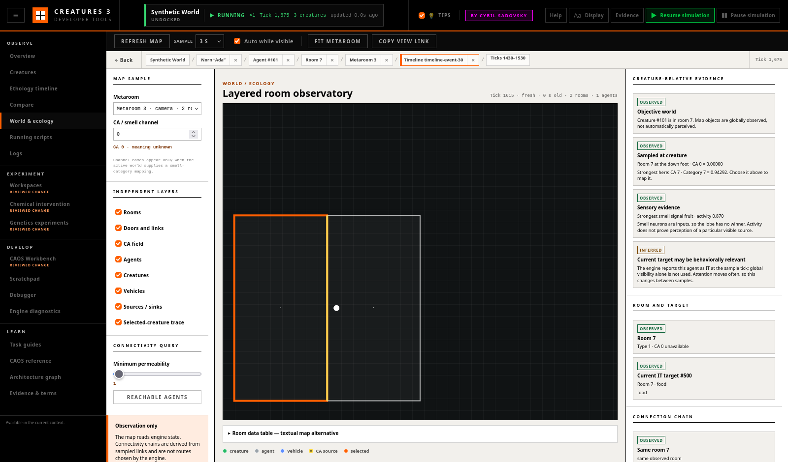

# World and Ecology Observatory

The **World** workspace observes the room graph in which creature behaviour
occurs. It combines engine room geometry, doors, linked rooms, agents, CA
samples, emission sources, and a selected creature's atomic observation
without editing the world or replacing engine navigation.

## Start From a Creature

Select a creature in **Creatures**, **Timeline**, or **Compare**, then open
**World**. The map follows the creature's metaroom on its first sample and
highlights its current room and position. The right-hand panel deliberately
separates four kinds of evidence:

- **Objective world — Observed:** globally sampled rooms, objects, sources,
  and the engine's current `IT` target. A visible object is not presented as
  perceived.
- **Sampled at creature — Observed:** the requested CA value in the room at the
  creature's down foot, which is where the smell lobe reads. CA 0 is not
  automatically the current food smell, so the card also names the strongest
  channel in that room. A zero is genuine when every channel reads zero.
- **Sensory evidence — Observed or Unknown:** the strongest smell-lobe neuron and
  its activity. Smell neurons are inputs, so the lobe has no winner. This does
  not prove perception of a particular global source.
- **Relevance — Inferred or Unknown:** only the engine-reported current target
  supports the labelled relevance inference. Map proximity alone does not.

Clicking an agent inspects it and shares its agent/room context with the other
tools. It does not change the creature's target, run CAOS, or move anything.

## Map Layers

Every layer can be toggled independently:

- **Rooms** use the engine's four sloped room boundaries and show raw room IDs.
- **Doors and links** use the engine map collections. Solid yellow segments
  are doors; dashed magenta segments are explicit linked-room connections.
  Red dashes fall below the chosen display threshold.
- **CA field** shades each room by the requested channel's current sampled
  magnitude. Hover a room for its raw value.
- **Agents**, **Creatures**, and **Vehicles** can be reduced independently.
  Vehicles are identified by their engine agent type; the workspace does not
  guess that every vehicle is a lift.
- **Sources / sinks** outline agents whose configured CA emission channel
  matches the selected channel. Yellow is positive emission and pink is
  negative emission.
- **Trace** retains at most 80 browser-polled positions for the selected
  creature. It resets on creature, metaroom, world, or tick regression.

The response is bounded to 400 matching rooms, 500 matching agents, 2,000
matching connections, and four requested CA channels. This workspace requests
one channel and asks the endpoint to retain the selected creature if an
agent-dense result must be truncated. Reaching a limit produces a visible
warning instead of implying the map is complete. Automatic polling runs only
while World is visible.

## CA and Smell Channels

Enter a CA channel from 0 through 19. A biological/category name appears only
when the active world's smell-category configuration maps that channel to a
sensory category. Otherwise the control says **meaning unknown**. CA IDs are
world configuration, not universal biological meanings.

Each room returns the current value, engine-reported recent change, and
projected value at one engine-main-thread sample tick. The UI currently shades
the current value and preserves the other fields in the structured API.
**Configured navigable** means the map says that CA index participates in CA
navigation; it does not mean the selected creature chose it for the current
action.

## Connection and Route Evidence

Inspect a target agent to compare its room with the selected creature's room.
The route panel reports:

- source and target room;
- same-room status, a derived connection chain, or an unavailable/disconnected
  explanation;
- every sampled connection's permeability and the chosen display threshold;
- target-room minus source-room CA value;
- the most recent permeability change observed by this browser.

The candidate chain is a breadth-first connectivity calculation over the
bounded sampled graph. It is explicitly **not an engine-selected route** and
does not reproduce creature collision size, vehicle scripts, approach state,
or all navigation rules. If either room falls outside the sample, the chain is
unavailable rather than guessed.

**Reachable agents** lists sampled agents connected from the selected room at
the display threshold. World-supplied category labels can identify food-like
agents, but graph reachability is not proof that an agent is edible, perceived,
or currently affordable.

## Investigate a Failed Food Approach

1. Use a disposable Docking Station world and select the creature before the
   suspected approach.
2. Open **World**, note the sample tick, current room, engine-reported target,
   and smell-lobe winner.
3. Choose the CA channel supplied by the world's relevant smell-category
   mapping; do not assign a name to an unmapped channel.
4. Inspect positive sources, the creature-room value, target-room value, and
   intervening door/link permeability.
5. Inspect vehicles in the relevant rooms. A vehicle marker establishes agent
   type and location, not whether its scripts will carry the creature.
6. Use **Reachable agents** and the candidate connection chain as graph
   evidence. Keep its derived label in notes.
7. Continue sampling across the failure and check **Recent connection change**.
   Correlate the same tick range in **Timeline** and the script **Debugger**.
8. Prefer a report such as “the target was in room 621; linked room 658 was
   connected at permeability 100; CA 6 was lower in the source room.” Do not
   conclude that the creature perceived the food or that the link caused the
   failure without additional evidence.

This path is suitable for observing the eat/elevator scenario described in
the repository README. The observatory does not modify targetless `APPR`,
linked-room direction selection, elevator behaviour, or smell recovery.

## Sampling, Freshness, and Reproduction

The sample footer records endpoint, world/system ticks, browser wall-time age,
limits, truncation, and read-only status. A sample becomes stale after twice
the chosen wall-time interval. Engine pause keeps the API responsive; world
ticks stop while wall-time freshness continues.

**Copy view link** serializes the tab, world identity, metaroom, CA channel,
permeability threshold, and shared selections. Layer toggles are restored
through browser investigation history. A link for another world is rejected
by shared navigation instead of resolving IDs in the wrong world.

The recent trace and connection-change history exist only in browser memory
and are not written into world saves.
