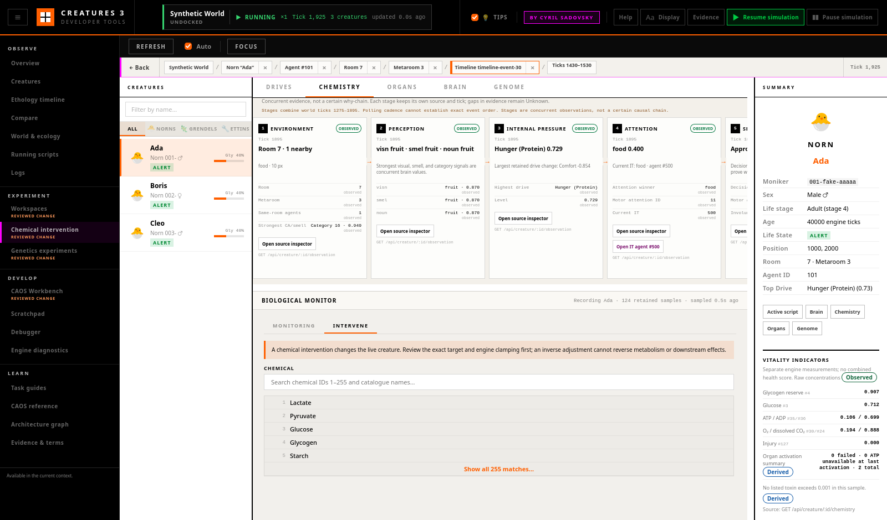

# Task 13 — Safe Chemical Interventions

Status: Completed

Depends on: Tasks 07 and 12

## Goal

Replace raw chemical mutation controls with a legible, recorded intervention
workflow that encourages baseline observation and makes consequences easy to
follow.

## Why this task exists

Injecting a chemical is useful for learning and diagnosis, but it is also a
state-changing experiment. A bare value field and action button obscure the
current concentration, timing, clamping semantics, and whether the change was
ever recorded.

The interface should support experimentation without implying that a biological
process can be perfectly undone.

## Feature scope

### Intervention composer

For the selected creature and chemical, show:

- creature identity and selection freshness;
- chemical identifier and trusted name;
- current concentration and sample tick;
- proposed dose or target operation;
- immediate projected value using the engine's actual numeric semantics;
- validation, range, and clamping information;
- whether the world will be paused for the operation;
- measurements that will be pinned and recorded afterward.

### Safer presets

Offer clearly described choices such as:

- small positive dose;
- small negative adjustment, only when supported;
- custom amount;
- protocol-defined dose.

Presets must show their numeric operation. Avoid labels such as “normal” or
“healthy” unless biologically justified.

### Observe before and after

Encourage, and in experiment mode automate:

1. a baseline window;
2. the intervention at a recorded world tick;
3. a follow-up observation window;
4. comparison of concentration, drives, attention, behaviour, and relevant
   organ readings.

The user can skip the baseline, but the ledger should say so.

### Result and recovery

Report the engine-confirmed result rather than assuming success. A follow-up
action may apply an inverse numeric adjustment, but it must not be called
“undo”: metabolism and downstream effects may already have changed the system.

Recommend branching or reloading a baseline for genuine experimental recovery.

## Safety rules

- Require an unambiguous live creature selection.
- Preview the exact operation and target before mutation.
- Use explicit confirmation for unusual or extreme amounts.
- Record the operation and observed result in the experiment ledger.
- Prevent duplicate submission while an operation is pending.
- Never silently resume a world that the user had already paused.
- Clearly distinguish concentration, dose, and change.

## Technical direction

- Centralize chemical range, scaling, and clamping rules rather than duplicating
  them in UI components.
- Use a narrow mutation API that returns before value, requested change, observed
  after value, world tick, and any warning.
- Bind the resulting marker to chemistry graphs and the ethology timeline.
- Preserve the raw chemical identifier in exports even when a display name is
  available.
- Treat a stale selection or changed world as a failed precondition.

## Documentation and in-product guidance

- Document chemical identity, concentration, dose, adjustment, range, clamping,
  preview, ledger, and before/after recording semantics.
- Add contextual tips for baseline collection, projected immediate values,
  extreme amounts, paused execution, and downstream effects.
- Add a task guide for a small recorded intervention followed by biological and
  behavioural observation.
- Remove “undo,” “restore health,” or similar language where an inverse numeric
  change cannot restore the prior biological state.

## Deliverables

- Chemical intervention composer and preview.
- Validation and confirmation states.
- Before/after recording integration.
- Timeline and graph markers.
- Provenance ledger entries and export support.
- Focused safety tests.

## Acceptance criteria

- The exact creature, chemical, operation, and projected immediate result are
  visible before execution.
- The returned before and after values and operation tick are visible afterward.
- A stale or missing target cannot be mutated.
- The intervention appears in the same timebase as observed biological changes.
- No action is labelled as undo unless it genuinely restores the prior world
  state.
- Users can perform the workflow without writing CAOS.

## Verification

- Unit-test range checks, clamping previews, stale-target handling, and duplicate
  submission prevention.
- In an isolated world, record a baseline, apply a small dose, and verify the
  ledger, chemistry graph marker, and follow-up data.
- Test paused and running worlds, disconnect during submission, creature removal,
  and failed engine responses.

## Out of scope

- Diagnosing a creature from one chemical value.
- Guaranteeing biological reversibility.
- Replacing CAOS for advanced research procedures.

## Implementation and verification (2026-07-28)

Implemented the **Chemistry → Intervene** composer, pure preview/state model,
and narrow main-thread engine endpoint. The final review binds the request to
the sampled world, creature ID and moniker, chemical, concentration, and tick;
the engine revalidates those facts before applying an adjustment or target.
The workflow preserves pause state, prevents duplicate submission, requires
explicit confirmation for extreme or clamped changes, records the
engine-confirmed result in shared provenance, and adds graph and Timeline
markers at the returned operation tick. Manual, skipped, and experiment
baseline states are explicit, and the follow-up action is deliberately labelled
as an inverse adjustment rather than undo.

Documentation now includes the terminology, safety preconditions, protocol
preset syntax, baseline and follow-up workflow, failure semantics, API
contract, and recovery limitations in
[Safe Chemical Interventions](../docs/safe_chemical_interventions.md). The
Firefox capture below shows the final review and unusual-change confirmation:

Verification completed against the isolated disposable world
`Task 13 Safe Chemistry`:

- all 13 browser/model test files passed, including focused range, clamp,
  stale-selection, protocol-preset, pending-submission, and provenance tests;
- all 8 `DebugServerLogic` tests passed, including endpoint validation and
  target freshness tests;
- the complete C++ suite passed: 480/480 tests;
- a small live chemical 75 adjustment returned the observed before/after value,
  applied change, and operation tick; a second adjustment while paused left the
  engine paused;
- unconfirmed clamping, a 201-tick-old sample, and a creature removed after
  review were rejected without mutation;
- Firefox 152.0.6 exercised baseline capture, ordinary and extreme review
  dialogs, Escape and backdrop dismissal, successful submission, graph and
  Timeline markers, inverse-adjustment preparation, simulated disconnect and
  engine rejection, stale-sample disabling, and paused-world messaging;
- Firefox layout checks passed without document overflow at 720×728,
  1600×828, and 1920×908 inner viewports, and the console reported no unexpected
  errors.
