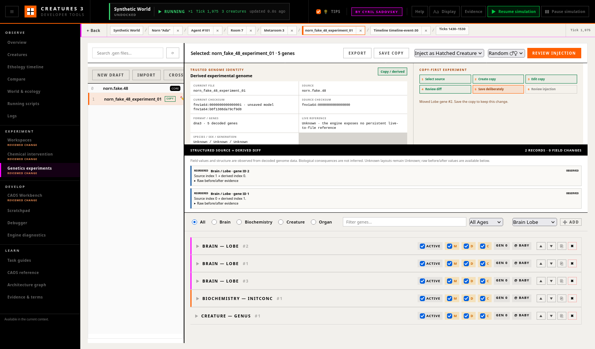

# Task 14 — Safe Genetics Experiments

Status: Completed

Depends on: Tasks 02 and 12

## Goal

Make genome inspection and modification a copy-first, diff-driven experiment
that protects original material and clearly exposes biological and provenance
consequences.

## Why this task exists

Genome tools can teach users how a creature is constructed, but mutations,
injections, and file operations are among the most consequential actions in the
developer UI. Raw editing encourages accidental work on the wrong genome and
makes it hard to understand what changed.

The desired workflow treats a genome as experimental material with an origin,
version, structured differences, and a deliberate route into a disposable
world.

## Feature scope

### Trusted genome identity

Display:

- source and current filename or local identifier;
- moniker and origin information when available;
- creature species, sex, and generation where trustworthy;
- genome format and gene count;
- whether the genome is referenced by a live creature;
- whether it is an original, copy, or derived experimental version.

Unknown metadata must remain visibly unknown.

### Copy-first workflow

Default mutation work to:

1. select a source genome;
2. create a uniquely named experimental copy;
3. record source identity and checksum;
4. edit the copy;
5. review a structured diff;
6. save deliberately;
7. inject or hatch only in a disposable or chosen branch world.

Direct modification of protected or original data should be unavailable or
require an exceptional, explicit workflow.

### Structured gene diff

Show changes by gene and field rather than only as raw bytes:

- added, removed, reordered, enabled, or disabled genes;
- header and expression changes;
- age and sex activation conditions;
- mutation flags and variability;
- decoded values with raw representation available on demand;
- confidence or decoding limitations.

Diff navigation should link to the relevant organ, brain lobe, tract, chemical,
or stimulus inspector when a reliable relationship exists.

### Injection and outcome tracking

Before introducing the genome into a world, show the chosen world, expected
operation, and known constraints. Record resulting monikers or creature
identifiers, failures, and world tick in the experiment ledger.

Comparisons should connect the derived creature back to its genome version and
control cohort.

### File safety

- Prevent path traversal and ambiguous filenames.
- Detect collisions before saving.
- Make overwrite and deletion separate, confirmed operations.
- Never make deletion a required step in ordinary editing.
- Do not place proprietary genome data or derived binaries in Git.

## Technical direction

- Define a versioned structured-diff model with stable gene identifiers where
  the format permits them.
- Compute and retain source and derived checksums.
- Keep decoding facts separate from interpretive biological labels.
- Expose narrow copy, save, and injection operations with explicit targets and
  result objects.
- Integrate all mutations and file operations with experiment provenance.
- Preserve a raw inspection mode for expert verification.

## Documentation and in-product guidance

- Document genome identity, copy-first editing, checksums, structured diff
  notation, protected sources, save rules, injection, and provenance.
- Add contextual warnings for editing a live-creature genome, overwriting,
  deleting, ambiguous filenames, and introducing a derived genome into a world.
- Add a task guide that creates an experimental copy, makes one bounded change,
  reviews it, and tracks the resulting creature or failure.
- Remove legacy instructions that normalize direct editing of originals or omit
  proprietary-data cautions.

## Deliverables

- Genome identity and provenance panel.
- Copy-first experiment flow.
- Structured gene diff and cross-navigation.
- Safe save, collision, and protection handling.
- Injection preview and outcome tracking.
- Unit and isolated-world tests.

## Acceptance criteria

- The default editing path never alters the selected source genome.
- A user can identify every changed gene and inspect its before and after values.
- The source, derived file, checksums, intervention, and injected result are
  linked in one provenance record.
- Protected originals cannot be overwritten through an ordinary save action.
- Inferred biological descriptions are labelled and raw data remains available.
- No genome or proprietary binary is added to the repository by the feature or
  its tests.

## Verification

- Unit-test copy naming, collision detection, path validation, checksums,
  structured diffing, and protected-source rules.
- In an isolated world, create an experimental copy, make one bounded edit,
  inspect the diff, and verify an injection result or clear failure.
- Test unknown genes, malformed files, read-only sources, duplicate names,
  cancellation, and disconnected engine state.

## Out of scope

- Redesigning the genome format.
- Automatic claims that a gene change caused an observed behaviour.
- Shipping or committing game genomes.

## Implementation and verification (2026-07-28)

Implemented a copy-first Genetics Kit with trusted binary identity,
FNV-1a-64 source and derived checksums, verified provenance sidecars,
read-only originals, create-only drafts, bounded known-layout serialization,
and transactional saves for experimental copies. The structured diff matches
genes by type, subtype, gene ID, and duplicate occurrence; it reports
structural and field changes with raw values and explicit decoding limits.
Final injection accepts only a saved checksum plus the reviewed source(s),
world, mode, sex, and two confirmations, then returns the engine-confirmed
result agent and operation tick for the shared experiment ledger.

The separate review pass tightened newly created names while retaining safe
dotted stock source names, made fixed serialization arrays mandatory, cleaned
failed staging files, distinguished malformed sidecars from absent metadata,
and removed an unsupported filename-to-live-creature inference. A live
relationship is now shown only for an engine-confirmed injection result in
the current browser session; otherwise it remains **Unknown**.

Documentation covers identity, checksums, badges, copy/save/crossover rules,
diff notation, injection, provenance, failure recovery, proprietary-data
boundaries, and a bounded end-to-end task guide in
[Safe Genetics Experiments](../docs/tab_genetics_kit.md). This Firefox capture
shows a verified copy with one observed field change:

Verification completed against the isolated disposable world
`Task 14 Genetics Confirm`:

- all 14 browser/model suites passed, including focused naming, Unicode
  checksum, stable matching, structural/field diff, unknown layout, fixed
  array/range, injection-readiness, redaction, and ledger-verification tests;
- all 13 `DebugServerLogic` tests passed, and the complete C++ suite passed
  485/485 tests;
- live API checks copied protected dotted source `norn.astro.48`, made and
  reloaded one bounded InitConc change, preserved the source checksum,
  rejected traversal, dotted new names, collisions, original mutation,
  stale checksums, out-of-range and missing-array payloads, unconfirmed or
  source-mismatched injection, and verified-copy deletion without its exact
  confirmation;
- malformed/truncated `dna3` input returned an explicit decode error, while a
  deliberately stale sidecar became `invalid_or_stale`, lost experimental
  privileges, and could not be saved, renamed, injected, or deleted through
  the ordinary workflow;
- a reviewed male creature injection returned a live agent, generated genome
  moniker, source/derived checksums, world/system tick, and preserved running
  state; the current-session result linked to one verified
  `genome_injection` ledger entry;
- Firefox 152.0.6 exercised protected read-only inspection, dotted-source copy
  naming, copy creation, bounded editing, exact diff/raw evidence, save/reload,
  final-review confirmations, Escape and backdrop cancellation, successful
  injection, result cross-navigation, experiment provenance, simulated
  disconnect, and zero unexpected console errors or warnings;
- responsive checks passed at 720×900, 1600×914, and 1920×1080 with no
  document or Genetics panel overflow. The screenshot was captured and
  inspected at the standard viewport;
- `git diff --check`, JavaScript syntax checks, documentation-index JSON
  parsing, and the full build passed. All runtime genomes, sidecars, worlds,
  creature galleries, and malformed fixtures stayed in disposable `/tmp`
  data and were not added to Git.
